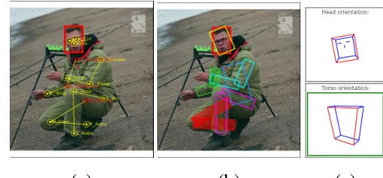
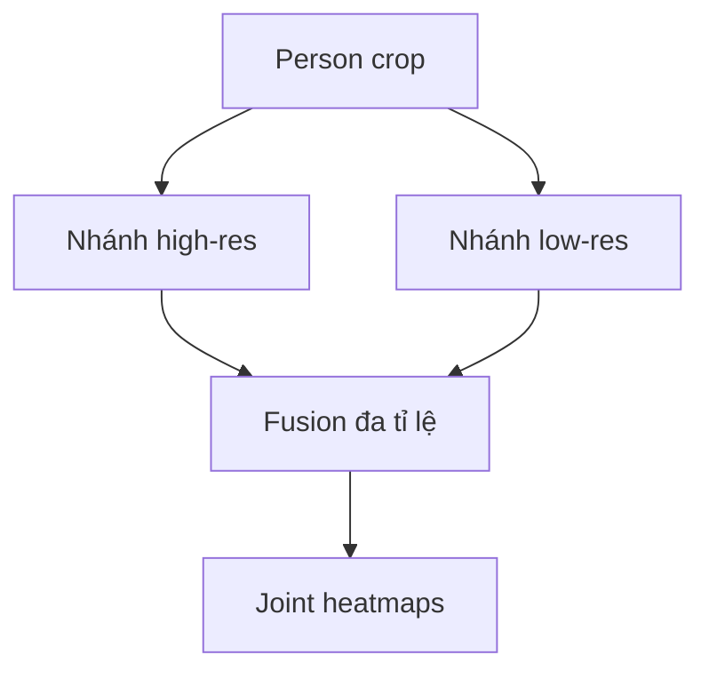

# MPII · Keypoint cơ thể

Person crop → heatmap và tọa độ từng khớp.

**Metric** · PCKh@0.5 ↑ trên khớp có nhãn

**Đề luyện 5 tiếng** · Tách theo ảnh trước khi crop từng người, giữ head box để chuẩn hóa khi chấm. [Dữ liệu và điều kiện truy cập](https://www.mpi-inf.mpg.de/departments/computer-vision-and-machine-learning/software-and-datasets/mpii-human-pose-dataset).

Cần biến đổi tọa độ khớp cùng phép crop trên từng người. *Trích Hình 3, ví dụ nhãn pose, Andriluka và cộng sự.* [PDF gốc, trang 3](https://openaccess.thecvf.com/content_cvpr_2014/papers/Andriluka_2D_Human_Pose_2014_CVPR_paper.pdf#page=3).

## Từ baseline đến mô hình mạnh

1. **Baseline.** Dự đoán vị trí trung bình từng khớp trong person box.
2. **Thử nghiệm tiếp theo.** Xem PCKh của cổ tay/cổ chân. Thay vector regression bằng heatmap Gaussian, tách visibility mask khi tính loss.
3. **Kiến trúc nghiên cứu.** HRNet giữ nhánh độ phân giải cao xuyên suốt để định vị khớp chính xác.

## Kiến trúc để thử

Khối code có thể tái sử dụng · [Bản đồ code và quy ước tensor của nhánh CV](../README.md).

## Mốc công bố và hướng SOTA

Bảng 3 HRNet báo PCKh@0.5 trên MPII test, có cột riêng cho đầu, vai, cổ tay và cổ chân. [Thí nghiệm hoặc kiến trúc gốc, tr. 6](https://openaccess.thecvf.com/content_CVPR_2019/papers/Sun_Deep_High-Resolution_Representation_Learning_for_Human_Pose_Estimation_CVPR_2019_paper.pdf#page=6).

Integral regression biến heatmap thành tọa độ bằng kỳ vọng. So PCKh khớp nhỏ ở cùng độ phân giải input. [Paper hoặc bảng đối chiếu](https://arxiv.org/abs/1711.08229).

[← Trở về danh sách 30 challenge](../README.md)
