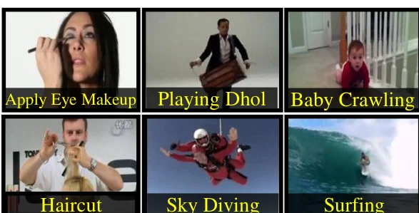
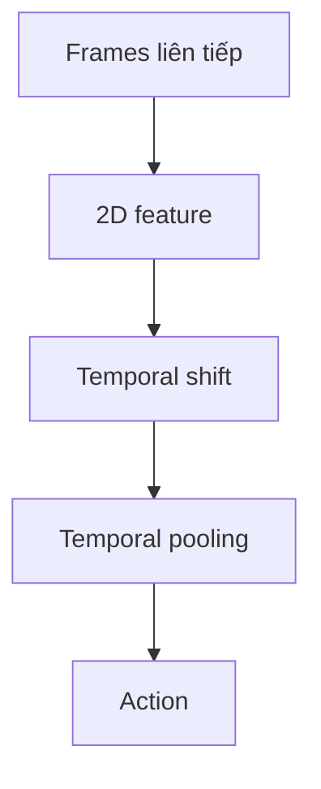

# UCF101 · Nhận diện hành động ngắn

Video → action class.

**Metric** · Top-1 accuracy theo video ↑

**Đề luyện 5 tiếng** · Chọn 10 lớp, dùng official split 1, cache 8 frame đều/video. [Dữ liệu và điều kiện truy cập](https://www.crcv.ucf.edu/research/data-sets/ucf101/).

Các frame cùng clip phải ở chung split để tránh rò rỉ gần trùng. *Trích Hình 1, các frame hành động, Soomro, Zamir & Shah.* [PDF gốc, trang 2](https://arxiv.org/pdf/1212.0402#page=2).

## Từ baseline đến mô hình mạnh

1. **Baseline.** CNN mỗi frame, average logits.
2. **Thử nghiệm tiếp theo.** So cặp động tác có frame đứng giống nhau. Thêm temporal shift rồi kiểm tra tác động khi đảo thứ tự frame.
3. **Kiến trúc nghiên cứu.** TSM dịch một phần kênh qua frame lân cận để trao đổi thông tin thời gian với 2D backbone.

## Kiến trúc để thử

Khối code có thể tái sử dụng · [Bản đồ code và quy ước tensor của nhánh CV](../README.md).

## Mốc công bố và hướng SOTA

TSM đối chiếu các tập video trong paper. Bài UCF101 phải lưu split ID, số frame và số clip/view lúc test. [Thí nghiệm hoặc kiến trúc gốc, tr. 5](https://openaccess.thecvf.com/content_ICCV_2019/papers/Lin_TSM_Temporal_Shift_Module_for_Efficient_Video_Understanding_ICCV_2019_paper.pdf#page=5).

TSN lấy các đoạn thưa trên toàn video, so độ phủ thời gian với nhiều frame tập trung ở giữa clip. [Paper hoặc bảng đối chiếu](https://mlanthology.org/eccv/2016/wang2016eccv-temporal/).

[← Trở về danh sách 30 challenge](../README.md)
