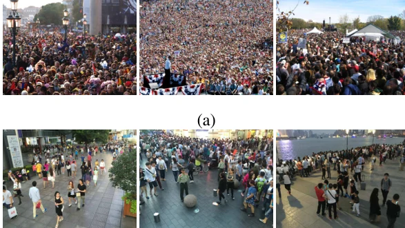
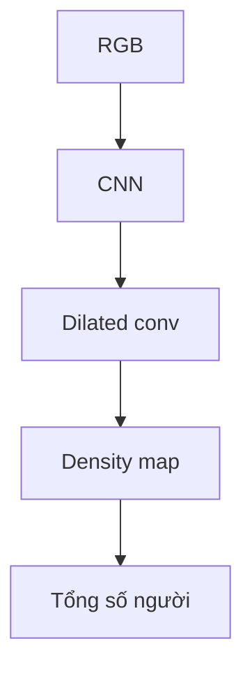

# ShanghaiTech · Đếm người trong đám đông

Ảnh + điểm tâm người → số người hoặc density map.

**Metric** · MAE và RMSE ↓, tách Part A và B

**Đề luyện 5 tiếng** · Chọn Part B, giữ split gốc. Chia theo ảnh trước khi crop, scale density để tổng bằng số điểm. [Dữ liệu và điều kiện truy cập](https://github.com/desenzhou/ShanghaiTechDataset).

Hai phần khác nhau về mật độ đám đông, cần báo điểm tách riêng. *Trích Hình 1, hai phần ShanghaiTech, Zhang và cộng sự.* [PDF gốc, trang 2](https://www.cv-foundation.org/openaccess/content_cvpr_2016/papers/Zhang_Single-Image_Crowd_Counting_CVPR_2016_paper.pdf#page=2).

## Từ baseline đến mô hình mạnh

1. **Baseline.** Dự đoán median count train.
2. **Thử nghiệm tiếp theo.** Xem MAE theo mật độ. Học density map từ Gaussian đã chuẩn hóa sau crop, đếm bằng tổng toàn ảnh.
3. **Kiến trúc nghiên cứu.** CSRNet thêm dilated convolutions để thấy bối cảnh rộng mà giữ resolution.

## Kiến trúc để thử

Khối code có thể tái sử dụng · [Loader ảnh và target pixel với hình học đồng bộ](../blocks/masks.py).

## Mốc công bố và hướng SOTA

Bảng 5 CSRNet báo MAE và sai số căn bình phương trung bình cho ShanghaiTech, tách Part A/B. [Thí nghiệm hoặc kiến trúc gốc, tr. 7](https://openaccess.thecvf.com/content_cvpr_2018/papers/Li_CSRNet_Dilated_Convolutional_CVPR_2018_paper.pdf#page=7).

DM-Count dùng distribution matching để giảm phụ thuộc Gaussian density targets. Kiểm tra tác động lên Part A và Part B riêng. [Paper hoặc bảng đối chiếu](https://proceedings.nips.cc/paper_files/paper/2020/hash/118bd558033a1016fcc82560c65cca5f-Abstract.html).

[← Trở về danh sách 30 challenge](../README.md)
