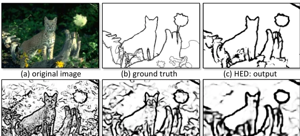
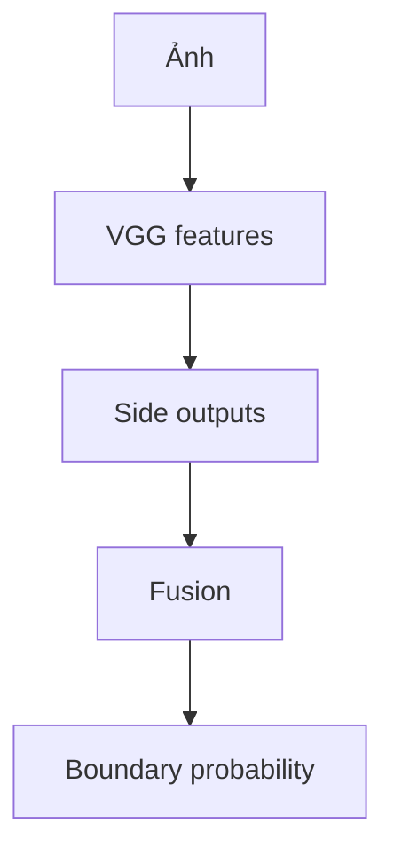

# BSDS500 · Phát hiện đường biên

RGB → bản đồ xác suất boundary.

**Metric** · ODS và OIS F-measure ↑ theo evaluator với tolerance

**Đề luyện 5 tiếng** · Giữ split BSDS500 và toàn bộ annotations của mỗi ảnh. Dùng dev để chọn scale. [Dữ liệu và điều kiện truy cập](https://www2.eecs.berkeley.edu/Research/Projects/CS/vision/grouping/resources.html).

Một texture có nhiều cạnh cục bộ dù vật chỉ có một biên ngoài. *Trích Hình 1, input và các bản đồ biên, Xie & Tu.* [PDF gốc, trang 1](https://openaccess.thecvf.com/content_iccv_2015/papers/Xie_Holistically-Nested_Edge_Detection_ICCV_2015_paper.pdf#page=1).

## Từ baseline đến mô hình mạnh

1. **Baseline.** Canny với cặp threshold cố định.
2. **Thử nghiệm tiếp theo.** Phân biệt biên texture và biên semantic. Học side outputs nhiều scale, fuse ở resolution ảnh.
3. **Kiến trúc nghiên cứu.** HED dùng deep supervision trên feature trung gian và fuse edge maps.

## Kiến trúc để thử

Khối code có thể tái sử dụng · [Loader ảnh và target pixel với hình học đồng bộ](../blocks/masks.py).

## Mốc công bố và hướng SOTA

Bảng 4 HED báo ODS 0,782 và OIS 0,804 trên BSDS500, ODS dùng chung một ngưỡng cả tập. [Thí nghiệm hoặc kiến trúc gốc, tr. 7](https://openaccess.thecvf.com/content_iccv_2015/papers/Xie_Holistically-Nested_Edge_Detection_ICCV_2015_paper.pdf#page=7).

PiDiNet đưa phép lấy hiệu pixel vào conv. So ODS/OIS với HED đồng thời đo CPU latency trên cùng resolution. [Paper hoặc bảng đối chiếu](https://openaccess.thecvf.com/content/ICCV2021/papers/Su_Pixel_Difference_Networks_for_Efficient_Edge_Detection_ICCV_2021_paper.pdf).

[← Trở về danh sách 30 challenge](../README.md)
