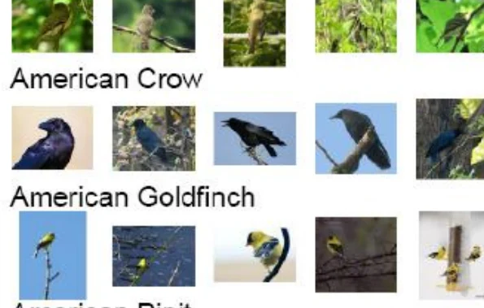
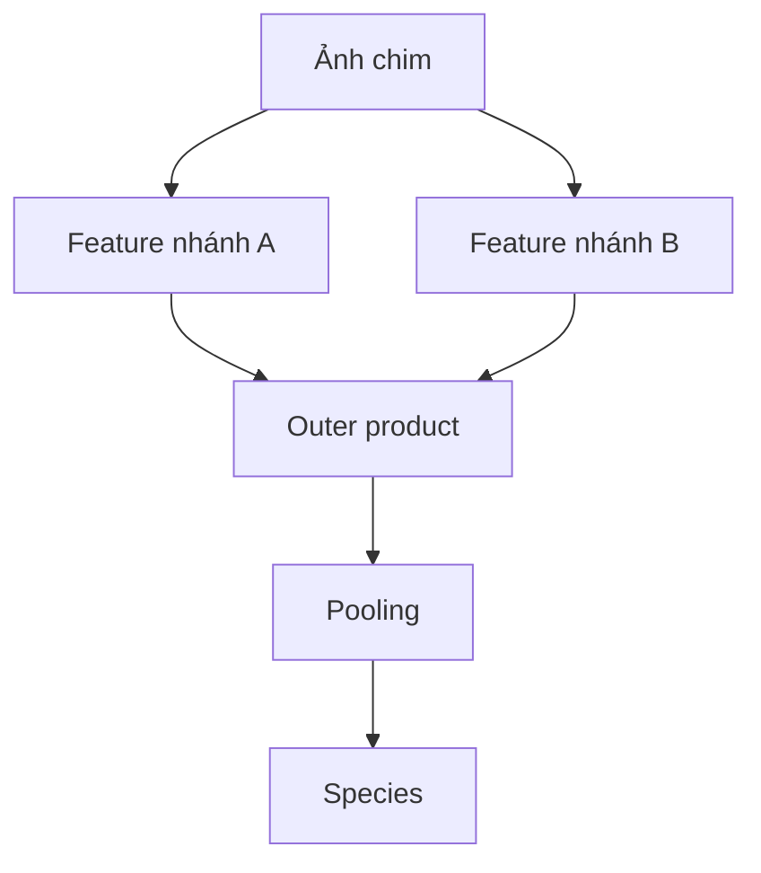

# CUB-200-2011 · Phân loài chim

Ảnh chim → species ID.

**Metric** · Top-1 accuracy ↑

**Đề luyện 5 tiếng** · Chọn 30 loài, giữ official split, báo có/không dùng box vàng, baseline whole-image. [Dữ liệu và điều kiện truy cập](https://www.vision.caltech.edu/datasets/cub_200_2011/).

Các loài gần nhau có thể chỉ khác ở hoa văn cánh hoặc đầu. *Trích Hình 1, một số loài chim, Wah và cộng sự.* [PDF gốc, trang 3](https://authors.library.caltech.edu/records/cvm3y-5hh21/files/CUB_200_2011.pdf#page=3).

## Từ baseline đến mô hình mạnh

1. **Baseline.** Linear probe trên global pooled feature hoặc CNN nông.
2. **Thử nghiệm tiếp theo.** Đối chiếu whole image với crop box để định lượng nền gây nhiễu. Thử pooling bậc hai trên feature.
3. **Kiến trúc nghiên cứu.** Bilinear CNN mô hình hóa tương tác cặp kênh cho fine-grained recognition.

## Kiến trúc để thử

Khối code có thể tái sử dụng · [Conv blocks và feature maps](../blocks/models.py).

## Mốc công bố và hướng SOTA

Bảng 1 Bilinear CNN báo accuracy loài. Đọc thông tin bbox/parts dùng lúc train và test. [Thí nghiệm hoặc kiến trúc gốc, tr. 6](https://openaccess.thecvf.com/content_iccv_2015/papers/Lin_Bilinear_CNN_Models_ICCV_2015_paper.pdf#page=6).

MA-CNN học nhiều vùng chú ý cho các bộ phận. Kiểm tra gain khi inference whole-image và khi cung cấp box. [Paper hoặc bảng đối chiếu](https://openaccess.thecvf.com/content_ICCV_2017/papers/Zheng_Learning_Multi-Attention_Convolutional_ICCV_2017_paper.pdf).

[← Trở về danh sách 30 challenge](../README.md)
