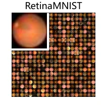
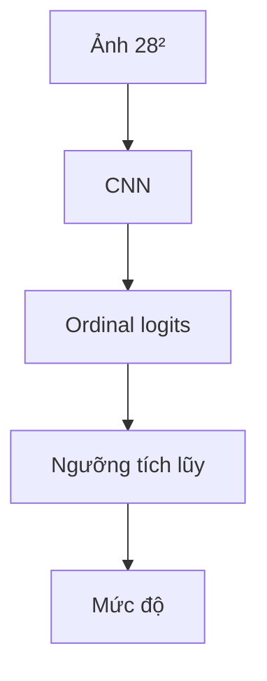

# RetinaMNIST · Phân độ theo thang thứ tự

Ảnh võng mạc thu nhỏ → một trong 5 mức độ.

**Metric** · Accuracy và AUC theo MedMNIST, thêm MAE theo bậc ↓

**Đề luyện 5 tiếng** · Giữ split RetinaMNIST sẵn có. Chọn size 28 để so baseline paper, ghi size khi đổi. [Dữ liệu và điều kiện truy cập](https://medmnist.com/v2).

Quan sát kích thước chi tiết sau khi đưa ảnh về resolution benchmark. *Trích Hình 1, ô RetinaMNIST, Yang và cộng sự.* [PDF gốc, trang 2](https://arxiv.org/pdf/2110.14795#page=2).

## Từ baseline đến mô hình mạnh

1. **Baseline.** Logistic regression với pixel chuẩn hóa.
2. **Thử nghiệm tiếp theo.** Xem ma trận nhầm theo khoảng cách giữa hai bậc. Thay softmax bằng các ngưỡng tích lũy và đo MAE.
3. **Kiến trúc nghiên cứu.** CORAL ràng buộc thứ tự các ngưỡng. Đây là kiến trúc ordinal để thử trên split RetinaMNIST.

## Kiến trúc để thử

Khối code có thể tái sử dụng · [Softmax và bốn ngưỡng ordinal trên cùng dữ liệu](../ordinal.py).

## Mốc công bố và hướng SOTA

CORAL gốc đánh giá tuổi. Bảng 3 của MedMNIST v2 là nguồn so trực tiếp cho RetinaMNIST, hai bài dùng tiêu chí thứ tự khác nhau. [Thí nghiệm hoặc kiến trúc gốc, tr. 6](https://arxiv.org/pdf/1901.07884#page=6).

Dùng bảng RetinaMNIST 28×28 của tác giả để so baseline shallow với ResNet hoặc AutoML. So cùng AUC/ACC trên official test. [Paper hoặc bảng đối chiếu](https://medmnist.com/v2).

**Run CPU.** Softmax đạt accuracy 0,5000 và MAE 0,8833. Ordinal logistic đạt **0,5333** và **0,8417** trên validation, với cùng đặc trưng RGB. [Tái lập](../README.md#tái-lập-bài-retinamnist).

[← Trở về danh sách 30 challenge](../README.md)
