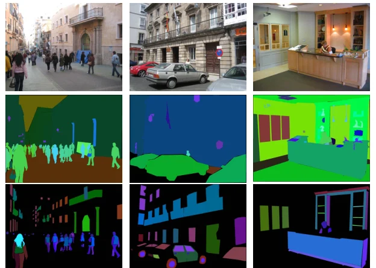
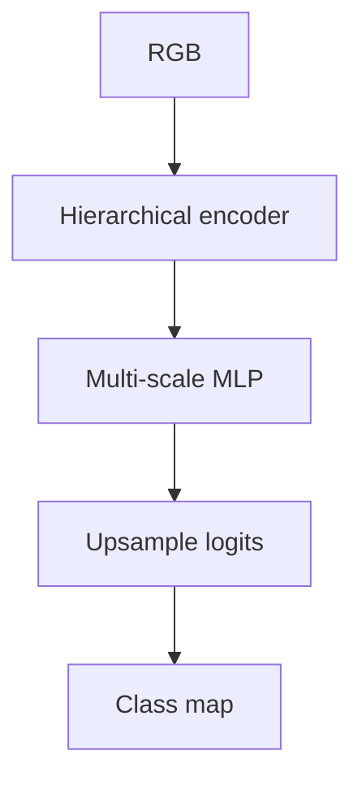

# ADE20K · Scene parsing nhiều lớp

Ảnh cảnh → class ID cho mỗi pixel.

**Metric** · mIoU ↑ tính theo các lớp được định nghĩa trước

**Đề luyện 5 tiếng** · Bài rút gọn chọn 15 lớp trên train, map lớp còn lại thành ignore rồi dùng đúng map trên dev. [Dữ liệu và điều kiện truy cập](https://ade20k.csail.mit.edu/).

Phân biệt mask đối tượng với các part bên trong cùng đối tượng. *Trích Hình 1, vài ví dụ ảnh và nhãn, Zhou và cộng sự.* [PDF gốc, trang 2](https://arxiv.org/pdf/1608.05442#page=2).

## Từ baseline đến mô hình mạnh

1. **Baseline.** FCN một mức feature và weighted CE.
2. **Thử nghiệm tiếp theo.** Lớp hiếm mất hoàn toàn ở crop. Lấy mẫu crop có lớp hiếm và dùng context module trước khi đổi backbone.
3. **Kiến trúc nghiên cứu.** SegFormer kết hợp encoder phân cấp với MLP decoder nhẹ, công bố trên ADE20K đầy đủ.

## Kiến trúc để thử

Khối code có thể tái sử dụng · [Loader ảnh và target pixel với hình học đồng bộ](../blocks/masks.py).

## Mốc công bố và hướng SOTA

Bảng 2 SegFormer đánh giá ADE20K full. Thu hẹp còn 15 lớp làm đổi mẫu số mIoU. [Thí nghiệm hoặc kiến trúc gốc, tr. 7](https://arxiv.org/pdf/2105.15203#page=7).

Mask2Former cho các mask queries tập trung vào vùng pixel dự đoán. Khi chuyển sang subset, so ảnh hưởng của mask loss trên lớp nhỏ với FCN cùng backbone. [Paper hoặc bảng đối chiếu](https://openaccess.thecvf.com/content/CVPR2022/html/Cheng_Masked-Attention_Mask_Transformer_for_Universal_Image_Segmentation_CVPR_2022_paper.html).

[← Trở về danh sách 30 challenge](../README.md)
