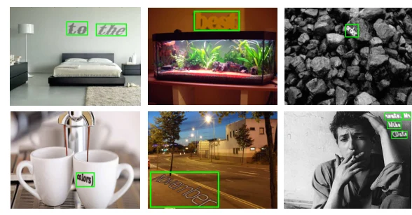
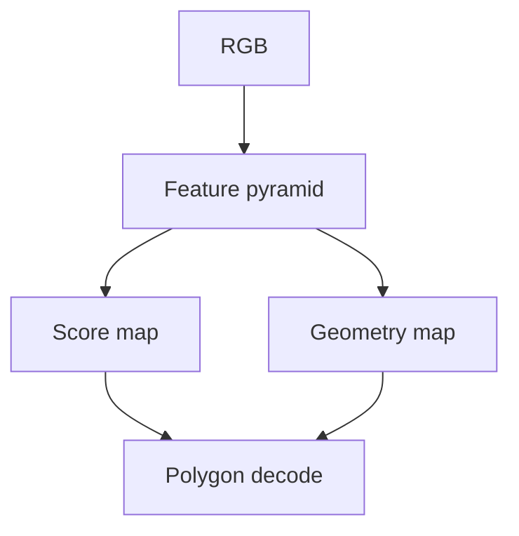

# SynthText · Định vị chữ xoay

Ảnh + tứ giác từng từ → polygon/rotated boxes.

**Metric** · Precision, recall, H-mean ↑ với polygon IoU ≥0.5 cho bài luyện

**Đề luyện 5 tiếng** · Lấy 2.000 ảnh từ SynthText, group theo ảnh nền khi có ID. Giữ bốn đỉnh theo thứ tự. [Dữ liệu và điều kiện truy cập](https://www.robots.ox.ac.uk/~vgg/data/scenetext/).

Đường bao chữ nghiêng cần biểu diễn bằng tứ giác. *Trích Hình 2, ví dụ chữ được tổng hợp, Gupta, Vedaldi & Zisserman.* [PDF gốc, trang 2](https://openaccess.thecvf.com/content_cvpr_2016/papers/Gupta_Synthetic_Data_for_CVPR_2016_paper.pdf#page=2).

## Từ baseline đến mô hình mạnh

1. **Baseline.** Rasterize vùng chữ, train binary segmenter rồi fit min-area box từng component.
2. **Thử nghiệm tiếp theo.** Đếm từ dính nhau, dùng shrink mask khi train và mở lại ở decode. Không đổi tứ giác sang xyxy khi chấm.
3. **Kiến trúc nghiên cứu.** EAST dự đoán score map và geometry của vùng chữ trên cùng feature map.

## Kiến trúc để thử

Khối code có thể tái sử dụng · [Loader ảnh và target pixel với hình học đồng bộ](../blocks/masks.py).

## Mốc công bố và hướng SOTA

EAST báo H-mean trên ICDAR và các benchmark scene text. SynthText thường dùng để train, bài rút gọn cần báo riêng kết quả tổng hợp. [Thí nghiệm hoặc kiến trúc gốc, tr. 8](https://openaccess.thecvf.com/content_cvpr_2017/papers/Zhou_EAST_An_Efficient_CVPR_2017_paper.pdf#page=8).

DBNet học threshold map và text map. Đo tỉ lệ các từ bị dính sau contour extraction. [Paper hoặc bảng đối chiếu](https://cdn.aaai.org/ojs/6812/6812-13-10041-1-10-20200524.pdf).

[← Trở về danh sách 30 challenge](../README.md)
