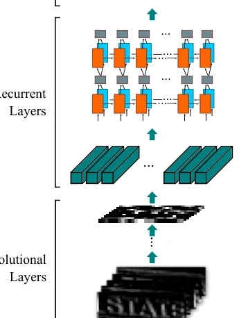
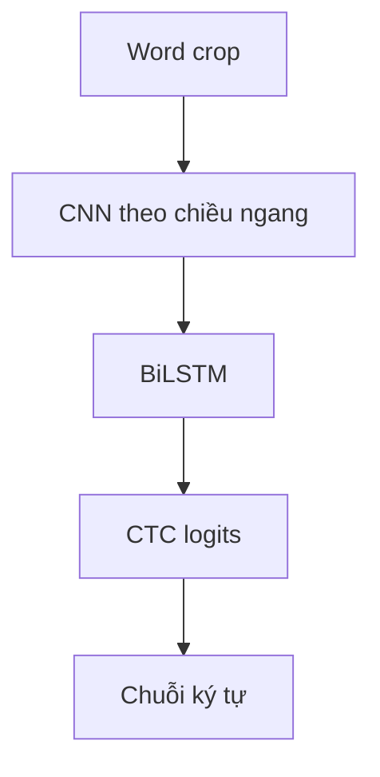

# IIIT5K · Đọc chữ trong crop

Ảnh từ → chuỗi ký tự độ dài thay đổi.

**Metric** · Word accuracy ↑, lexicon-free và cùng chính sách case

**Đề luyện 5 tiếng** · Dùng train IIIT5K, group theo word khi muốn stress test từ mới. Resize theo tỉ lệ rồi pad chiều ngang. [Dữ liệu và điều kiện truy cập](https://cvit.iiit.ac.in/research/projects/cvit-projects/the-iiit-5k-word-dataset).

Chiều rộng feature map quyết định số bước căn chỉnh CTC. *Trích Hình 1 của CRNN, luồng từ word crop, Shi, Bai & Yao.* [PDF gốc, trang 2](https://arxiv.org/pdf/1507.05717#page=2).

## Từ baseline đến mô hình mạnh

1. **Baseline.** So embedding crop với prototype của từ đã thấy, báo riêng từ OOV.
2. **Thử nghiệm tiếp theo.** Đổi đầu phân lớp từ sang CTC ký tự, kiểm tra blank, repeated letters và width sau downsample.
3. **Kiến trúc nghiên cứu.** CRNN biến chiều ngang CNN thành chuỗi, qua BiLSTM và CTC, decode greedy trước beam.

## Kiến trúc để thử

Khối code có thể tái sử dụng · [Bản đồ code và quy ước tensor của nhánh CV](../README.md).

## Mốc công bố và hướng SOTA

Bảng 2 của CRNN tách IIIT5K lexicon 50, 1.000 và không lexicon. So cột không lexicon cho bài luyện. [Thí nghiệm hoặc kiến trúc gốc, tr. 7](https://arxiv.org/pdf/1507.05717#page=7).

PARSeq dùng permutation language modeling cho scene text. So lexicon-free word accuracy và tốc độ greedy decoding với CRNN. [Paper hoặc bảng đối chiếu](https://www.ecva.net/papers/eccv_2022/papers_ECCV/papers/136880177.pdf).

[← Trở về danh sách 30 challenge](../README.md)
