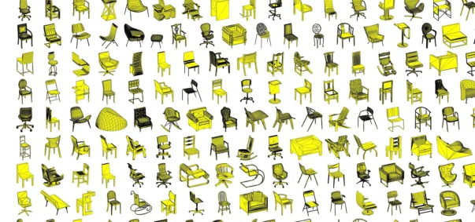
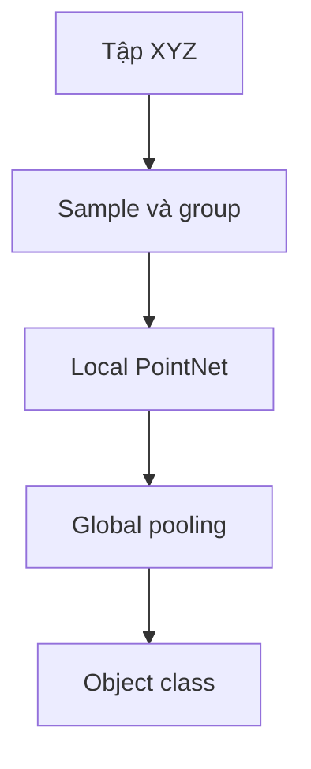

# ModelNet40 · Phân lớp point cloud

Tập 1.024 điểm xyz → loại đồ vật.

**Metric** · Overall accuracy và mean class accuracy ↑

**Đề luyện 5 tiếng** · Sample điểm từ surface, chuẩn hóa tâm và bán kính từng object, chia theo mesh trước augmentation. [Dữ liệu và điều kiện truy cập](https://modelnet.cs.princeton.edu/).

Các view của cùng một mesh phải ở cùng split. *Trích Hình 5, một số CAD models, Wu và cộng sự.* [PDF gốc, trang 5](https://arxiv.org/pdf/1406.5670#page=5).

## Từ baseline đến mô hình mạnh

1. **Baseline.** Histogram khoảng cách điểm đến tâm + SVM.
2. **Thử nghiệm tiếp theo.** Xoay quanh trục đứng và đo độ giảm. Học pointwise MLP rồi max-pool để bất biến theo thứ tự.
3. **Kiến trúc nghiên cứu.** PointNet++ gom neighborhood nhiều mức cho hình nhỏ và local geometry.

## Kiến trúc để thử

Khối code có thể tái sử dụng · [Bản đồ code và quy ước tensor của nhánh CV](../README.md).

## Mốc công bố và hướng SOTA

PointNet++ ablate đặc trưng input. Tách xyz-only với xyz + normals và ghi số điểm mỗi object. [Thí nghiệm hoặc kiến trúc gốc, tr. 5](https://arxiv.org/pdf/1706.02413#page=5).

PointNeXt ablate training recipe và scale. Giữ input xyz/normals, augmentation và số điểm ngang nhau trước khi so. [Paper hoặc bảng đối chiếu](https://proceedings.neurips.cc/paper_files/paper/2022/hash/9318763d049edf9a1f2779b2a59911d3-Abstract.html).

[← Trở về danh sách 30 challenge](../README.md)
