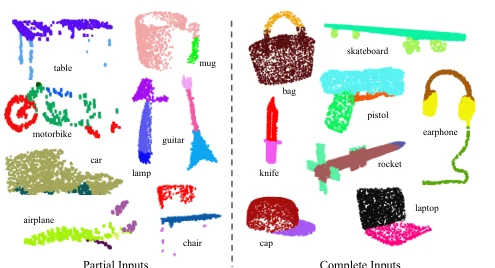
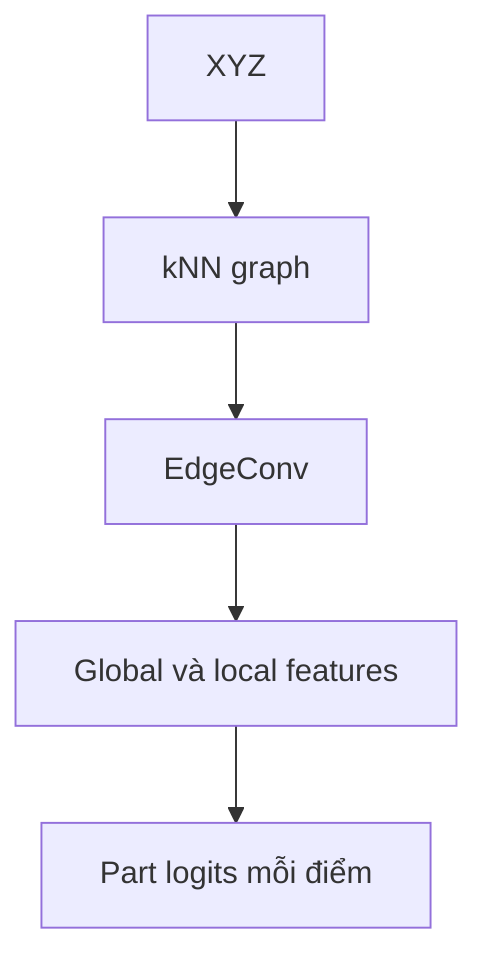

# ShapeNetPart · Gán nhãn bộ phận

Tập điểm cùng category → part ID từng điểm.

**Metric** · Instance mIoU và class mIoU ↑ theo benchmark ShapeNetPart

**Đề luyện 5 tiếng** · Chọn ghế và máy bay, chia theo object. Dùng danh sách part hợp lệ của từng category. [Dữ liệu và điều kiện truy cập](https://github.com/charlesq34/pointnet).

Màu biểu diễn part ID cần dự đoán ở từng điểm. *Trích Hình 3, kết quả point segmentation, Qi và cộng sự.* [PDF gốc, trang 5](https://arxiv.org/pdf/1612.00593#page=5).

## Từ baseline đến mô hình mạnh

1. **Baseline.** Nearest centroid theo xyz chuẩn hóa, centroid học riêng theo part và category.
2. **Thử nghiệm tiếp theo.** Góc xoay phá centroid. Thêm feature toàn object vào từng point và đo IoU trên part nhỏ.
3. **Kiến trúc nghiên cứu.** DGCNN xây lại kNN graph trong feature space sau mỗi EdgeConv, theo dõi chi phí khi tăng số điểm.

## Kiến trúc để thử

Khối code có thể tái sử dụng · [Bản đồ code và quy ước tensor của nhánh CV](../README.md).

## Mốc công bố và hướng SOTA

Bảng 6 DGCNN báo mIoU tổng và theo category ShapeNetPart. Báo instance/class mIoU riêng khi làm subset. [Thí nghiệm hoặc kiến trúc gốc, tr. 10](https://arxiv.org/pdf/1801.07829#page=10).

PointNeXt ablate training recipe và scale. Giữ input xyz/normals, augmentation và số điểm ngang nhau trước khi so. [Paper hoặc bảng đối chiếu](https://proceedings.neurips.cc/paper_files/paper/2022/hash/9318763d049edf9a1f2779b2a59911d3-Abstract.html).

[← Trở về danh sách 30 challenge](../README.md)
