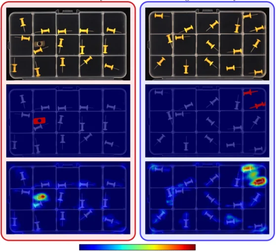
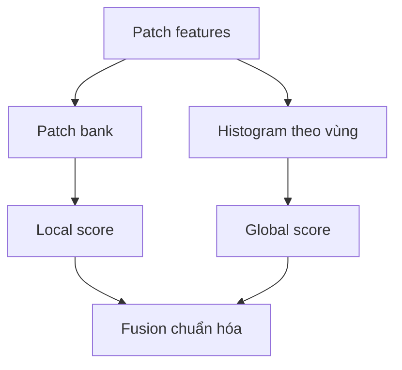

# MVTec LOCO AD · Phát hiện sai logic

Chỉ ảnh normal khi train → anomaly score cho ảnh mới.

**Metric** · Image AUROC ↑, tách structural/logical, localization chính thức dùng sPRO

**Đề luyện 5 tiếng** · Một category, ví dụ breakfast box, chia normal train thành bank/calibration, giữ mọi test label đến lượt cuối. [Dữ liệu và điều kiện truy cập](https://www.mvtec.com/research-teaching/datasets/mvtec-loco-ad).

So một lỗi cục bộ với vật vẫn nguyên vẹn nhưng vi phạm quy tắc sắp xếp. *Trích Hình 2, structural và logical anomaly, Bergmann và cộng sự.* [PDF gốc, trang 3](https://link.springer.com/content/pdf/10.1007/s11263-022-01578-9.pdf#page=3).

## Từ baseline đến mô hình mạnh

1. **Baseline.** Frozen feature → patch nearest neighbor → max distance.
2. **Thử nghiệm tiếp theo.** Nếu đếm sai số món nhưng mọi patch đều giống normal, max distance bỏ qua lỗi. Thêm histogram cụm patch theo vùng và so bằng chính split đó.
3. **Kiến trúc nghiên cứu.** EfficientAD dùng local student–teacher và nhánh autoencoder global để mô hình hóa sai lệch logic.

## Kiến trúc để thử

Khối code có thể tái sử dụng · [Fit memory từ normal train và trả heatmap theo lưới](../blocks/anomaly.py).

## Mốc công bố và hướng SOTA

Bảng 2, EfficientAD-M đạt 90,7% image AUROC trên LOCO, gồm 86,8% logical và 94,7% structural. Phân rã này giúp chọn giữa cải tiến global và local. [Thí nghiệm hoặc kiến trúc gốc, tr. 7](https://openaccess.thecvf.com/content/WACV2024/papers/Batzner_EfficientAD_Accurate_Visual_Anomaly_Detection_at_Millisecond-Level_Latencies_WACV_2024_paper.pdf#page=7).

CSAD học phân đoạn component, khi sai logic là thiếu hoặc thừa vật, thử thống kê số lượng theo component và đối chiếu heatmap với nhánh patch. [Paper hoặc bảng đối chiếu](https://bmvc2024.org/proceedings/854/).

[← Trở về danh sách 30 challenge](../README.md)
