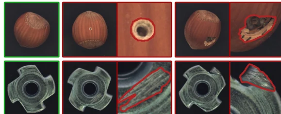
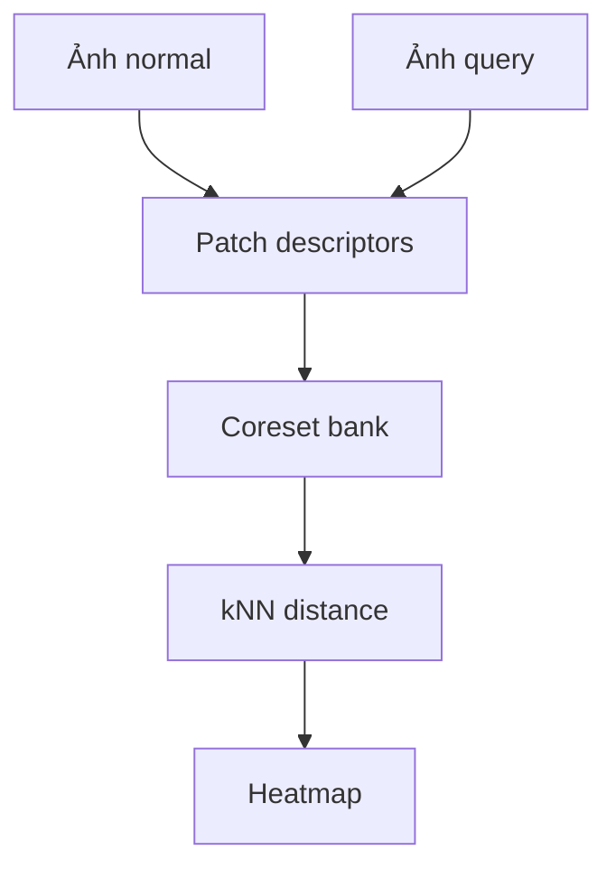

# MVTec AD · Defect chưa từng thấy

Ảnh normal train → heatmap và image score.

**Metric** · Image AUROC, pixel AUROC và AUPRO ↑

**Đề luyện 5 tiếng** · Chọn bottle và carpet để so object với texture. Fit chuẩn hóa và memory trên normal train. [Dữ liệu và điều kiện truy cập](https://www.mvtec.com/research-teaching/datasets/mvtec-ad).

Vùng lỗi có thể nhỏ hơn nhiều so với vùng normal trong cùng ảnh. *Trích Hình 1, các object và texture, Bergmann và cộng sự.* [PDF gốc, trang 1](https://openaccess.thecvf.com/content_CVPR_2019/papers/Bergmann_MVTec_AD_--_A_Comprehensive_Real-World_Dataset_for_Unsupervised_Anomaly_CVPR_2019_paper.pdf#page=1).

## Từ baseline đến mô hình mạnh

1. **Baseline.** Kho patch RGB chuẩn hóa, score là khoảng cách tới patch train gần nhất.
2. **Thử nghiệm tiếp theo.** Kiểm tra top-scoring patch của normal dev. Thay RGB bằng feature nhiều tầng rồi giảm memory bằng coreset.
3. **Kiến trúc nghiên cứu.** PatchCore dùng patch descriptors từ pretrained backbone và greedy coreset, so cùng kích thước ảnh.

## Kiến trúc để thử

Khối code có thể tái sử dụng · [Fit memory từ normal train và trả heatmap theo lưới](../blocks/anomaly.py).

## Mốc công bố và hướng SOTA

Bảng 1–2 PatchCore tách detection cấp ảnh và segmentation cấp pixel, có ablation tỷ lệ coreset. [Thí nghiệm hoặc kiến trúc gốc, tr. 6](https://openaccess.thecvf.com/content/CVPR2022/papers/Roth_Towards_Total_Recall_in_Industrial_Anomaly_Detection_CVPR_2022_paper.pdf#page=6).

UniNet học representation chung và chọn feature cho anomaly detection đa lớp. Đọc điều kiện huấn luyện trước khi so zero-shot với full-shot. [Paper hoặc bảng đối chiếu](https://openaccess.thecvf.com/content/CVPR2025/html/Wei_UniNet_A_Contrastive_Learning-guided_Unified_Framework_with_Feature_Selection_for_CVPR_2025_paper.html).

[← Trở về danh sách 30 challenge](../README.md)
