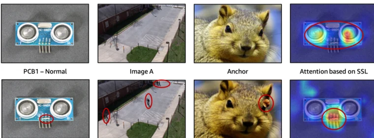
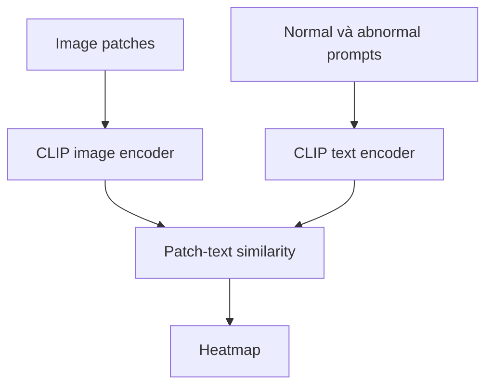

# VisA · Nhiều đối tượng trong ảnh kiểm lỗi

Ảnh sản phẩm → score và mask bất thường.

**Metric** · Image AUROC và pixel average precision ↑ cho bài luyện

**Đề luyện 5 tiếng** · Dùng 1-class split của VisA và hai category khác nhau, tách normal calibration khỏi bank. [Dữ liệu và điều kiện truy cập](https://github.com/amazon-science/spot-diff).

So patch linh kiện cùng vị trí trước và sau lỗi sản xuất. *Trích Hình 1a, PCB, Zou và cộng sự.* [PDF gốc, trang 2](https://arxiv.org/pdf/2207.14315#page=2).

## Từ baseline đến mô hình mạnh

1. **Baseline.** Mahalanobis distance của patch feature theo vị trí.
2. **Thử nghiệm tiếp theo.** Sản phẩm dịch vị trí làm tăng false positives, thử kNN không ràng buộc vị trí rồi thêm alignment thô.
3. **Kiến trúc nghiên cứu.** WinCLIP so patch với embedding prompt normal/abnormal ở nhiều window size, đọc riêng setting zero/few-shot.

## Kiến trúc để thử

Khối code có thể tái sử dụng · [Fit memory từ normal train và trả heatmap theo lưới](../blocks/anomaly.py).

## Mốc công bố và hướng SOTA

Bảng 1, WinCLIP zero-shot trên VisA đạt 78,1% image AUROC. Hàng one-shot/few-shot dùng thêm ảnh normal tham chiếu. [Thí nghiệm hoặc kiến trúc gốc, tr. 7](https://openaccess.thecvf.com/content/CVPR2023/papers/Jeong_WinCLIP_Zero-Few-Shot_Anomaly_Classification_and_Segmentation_CVPR_2023_paper.pdf#page=7).

UniNet học representation chung và chọn feature cho anomaly detection đa lớp. Đọc điều kiện huấn luyện trước khi so zero-shot với full-shot. [Paper hoặc bảng đối chiếu](https://openaccess.thecvf.com/content/CVPR2025/html/Wei_UniNet_A_Contrastive_Learning-guided_Unified_Framework_with_Feature_Selection_for_CVPR_2025_paper.html).

[← Trở về danh sách 30 challenge](../README.md)
