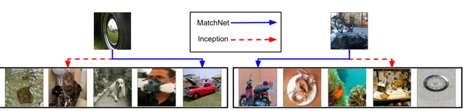
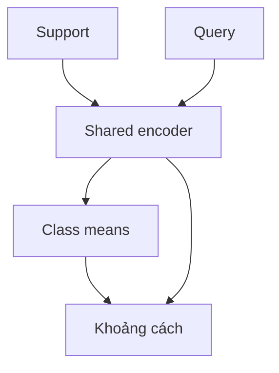

# miniImageNet · Phân lớp 5-way 1-shot

Mỗi episode gồm support và query thuộc 5 lớp → nhãn query.

**Metric** · Episode accuracy ↑, báo mean và khoảng tin cậy qua episode

**Đề luyện 5 tiếng** · Test trên lớp khác train, dùng một split miniImageNet được ghi tên, cố định danh sách episode khi so. [Dữ liệu và điều kiện truy cập](https://github.com/renmengye/few-shot-ssl-public).

Một episode cung cấp các ứng viên cụ thể để so với query mới. *Trích Hình 2 của Matching Networks, ví dụ episode, Vinyals và cộng sự.* [PDF gốc, trang 6](https://arxiv.org/pdf/1606.04080#page=6).

## Từ baseline đến mô hình mạnh

1. **Baseline.** Nearest support bằng cosine trên feature đóng băng.
2. **Thử nghiệm tiếp theo.** So 1-shot với 5-shot. Dùng trung bình support mỗi lớp và chuẩn hóa embedding trước tính khoảng cách.
3. **Kiến trúc nghiên cứu.** Prototypical Networks tối ưu encoder qua episode để metric phù hợp với centroid lớp.

## Kiến trúc để thử

Khối code có thể tái sử dụng · [Cosine, prototypes và recall theo group ID](../blocks/metrics.py).

## Mốc công bố và hướng SOTA

Bảng 2 ProtoNet, miniImageNet 5-way. 1-shot đạt 49,42 ± 0,78% và 5-shot đạt 68,20 ± 0,66%, cùng Euclidean metric. [Thí nghiệm hoặc kiến trúc gốc, tr. 6](https://arxiv.org/pdf/1703.05175#page=6).

Meta-Baseline tách pretraining phân lớp nguồn và tinh chỉnh qua episode. Chia class IDs trước cả hai giai đoạn. [Paper hoặc bảng đối chiếu](https://openaccess.thecvf.com/content/ICCV2021/html/Chen_Meta-Baseline_Exploring_Simple_Meta-Learning_for_Few-Shot_Learning_ICCV_2021_paper.html).

[← Trở về danh sách 30 challenge](../README.md)
