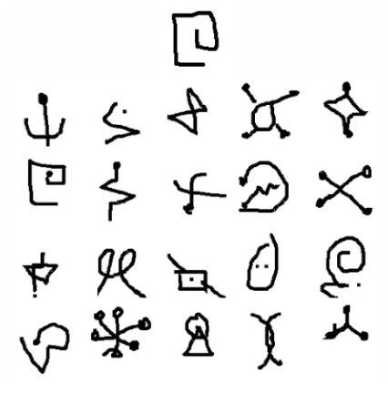
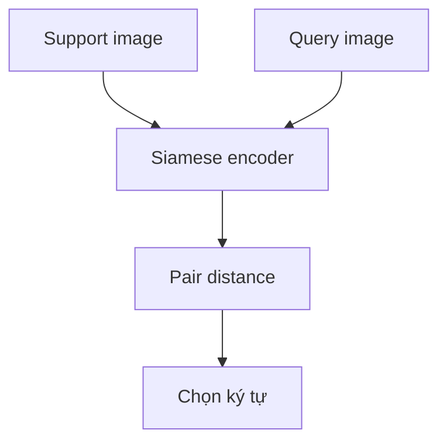

# Omniglot · Nhận dạng ký tự mới

Một ảnh chữ viết tay + support từng ký tự → ký tự tương ứng.

**Metric** · 20-way 1-shot episode accuracy ↑

**Đề luyện 5 tiếng** · Dùng background/evaluation alphabets chính thức, tách writer khi tự tạo episode, query khác ảnh support. [Dữ liệu và điều kiện truy cập](https://github.com/brendenlake/omniglot).

Hai chữ cùng lớp có thể khác rõ về nét do người viết. *Trích Hình 1, episode Omniglot, Koch, Zemel & Salakhutdinov.* [PDF gốc, trang 1](https://www.cs.cmu.edu/~rsalakhu/papers/oneshot1.pdf#page=1).

## Từ baseline đến mô hình mạnh

1. **Baseline.** Nearest neighbor trên ảnh nhị phân đã căn tâm.
2. **Thử nghiệm tiếp theo.** Đo sai số theo nét lệch/độ dày. Thử affine augmentation cho support rồi học Siamese embedding.
3. **Kiến trúc nghiên cứu.** Siamese network học verification giữa hai ảnh để chuyển sang nhận dạng lớp chưa thấy.

## Kiến trúc để thử

Khối code có thể tái sử dụng · [Cosine, prototypes và recall theo group ID](../blocks/metrics.py).

## Mốc công bố và hướng SOTA

Bảng 2 Siamese Network báo 20-way one-shot. Giữ rõ cách lấy alphabet và tạo distractor khi so điểm. [Thí nghiệm hoặc kiến trúc gốc, tr. 6](https://www.cs.cmu.edu/~rsalakhu/papers/oneshot1.pdf#page=6).

So Siamese pair scoring với prototype đa lớp. Cùng lấy 20-way, 1-shot và cùng cách tạo episode. [Paper hoặc bảng đối chiếu](https://proceedings.neurips.cc/paper_files/paper/2017/file/cb8da6767461f2812ae4290eac7cbc42-Paper.pdf).

**Run CPU.** 200 episode tự lấy từ 659 evaluation characters, seed 7, 20-way 1-shot. Pixel prototype đạt **29,20% accuracy**. [Tái lập](../README.md#tái-lập-bài-omniglot).

[← Trở về danh sách 30 challenge](../README.md)
