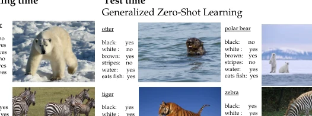
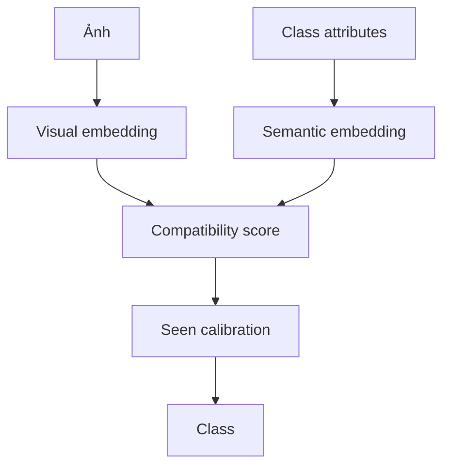

# CUB · Generalized zero-shot bằng thuộc tính

Ảnh + vector thuộc tính từng loài → loài seen hoặc unseen.

**Metric** · Harmonic mean của per-class accuracy seen/unseen ↑

**Đề luyện 5 tiếng** · Dùng proposed splits của Xian, tập thuộc tính cho unseen có sẵn, ảnh unseen chỉ dùng lúc đánh giá. [Dữ liệu và điều kiện truy cập](https://www.mpi-inf.mpg.de/departments/computer-vision-and-machine-learning/research/zero-shot-learning/zero-shot-learning-the-good-the-bad-and-the-ugly).

Ở GZSL, tập ứng viên lúc test gồm cả lớp đã thấy và chưa thấy. *Trích Hình 1, giao thức ZSL và GZSL, Xian và cộng sự.* [PDF gốc, trang 2](https://arxiv.org/pdf/1707.00600#page=2).

## Từ baseline đến mô hình mạnh

1. **Baseline.** Ridge từ feature ảnh sang attribute, nearest class prototype.
2. **Thử nghiệm tiếp theo.** Model thiên về seen classes. Trừ bias khỏi seen logits trên pseudo-unseen dev rồi so đường seen/unseen.
3. **Kiến trúc nghiên cứu.** ALE học compatibility ảnh–thuộc tính, dùng protocol GZSL của Xian để so hàng ngang.

## Kiến trúc để thử

Khối code có thể tái sử dụng · [Cosine, prototypes và recall theo group ID](../blocks/metrics.py).

## Mốc công bố và hướng SOTA

Bảng 5 của Xian và cộng sự dùng generalized zero-shot với proposed split, harmonic mean cần cả seen và unseen accuracy. [Thí nghiệm hoặc kiến trúc gốc, tr. 8](https://openaccess.thecvf.com/content_cvpr_2017/papers/Xian_Zero-Shot_Learning_-_CVPR_2017_paper.pdf#page=8).

TransZero truyền thông tin giữa thuộc tính và vùng ảnh, giữ proposed split và báo cả seen/unseen khi so GZSL. [Paper hoặc bảng đối chiếu](https://ojs.aaai.org/index.php/AAAI/article/view/19909).

[← Trở về danh sách 30 challenge](../README.md)
