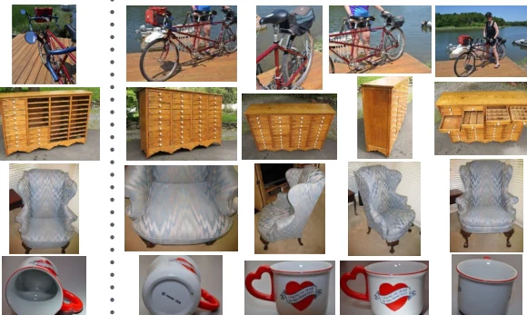
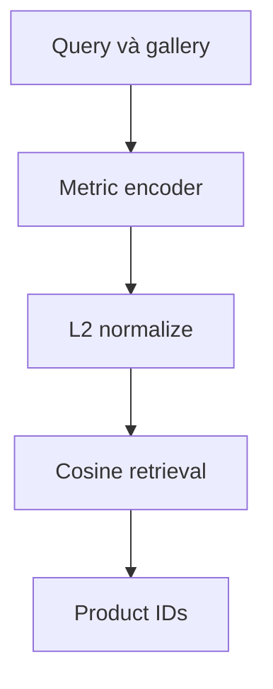

# Stanford Online Products · Tìm đúng sản phẩm

Query ảnh → xếp hạng ảnh của cùng product ID trong gallery.

**Metric** · Recall@1 và Recall@10 ↑

**Đề luyện 5 tiếng** · Tách product ID train/test theo official split, loại chính query khỏi gallery. [Dữ liệu và điều kiện truy cập](https://cvgl.stanford.edu/projects/lifted_struct/).

Giữ các ảnh cùng product ID trong tập positives dù góc nhìn khác nhau. *Trích Hình 1, một phần retrieval examples, Song và cộng sự.* [PDF gốc, trang 1](https://arxiv.org/pdf/1511.06452#page=1).

## Từ baseline đến mô hình mạnh

1. **Baseline.** Cosine nearest neighbors trên global CNN embeddings.
2. **Thử nghiệm tiếp theo.** Mine các negative cùng super-category nhưng khác ID. Batch P sản phẩm × K ảnh để có positives.
3. **Kiến trúc nghiên cứu.** Proxy Anchor Loss học proxy sản phẩm và điều khiển hard examples, so bằng cùng backbone.

## Kiến trúc để thử

Khối code có thể tái sử dụng · [Cosine, prototypes và recall theo group ID](../blocks/metrics.py).

## Mốc công bố và hướng SOTA

Bảng 3 Proxy Anchor báo Recall@K trên SOP và có ghi embedding dimension. Loại chính ảnh query khỏi tập truy hồi. [Thí nghiệm hoặc kiến trúc gốc, tr. 7](https://openaccess.thecvf.com/content_CVPR_2020/papers/Kim_Proxy_Anchor_Loss_for_Deep_Metric_Learning_CVPR_2020_paper.pdf#page=7).

Multi-Similarity Loss đặt trọng số lên nhiều positive/negative pairs. Cố định P×K batch và gallery để so R@1. [Paper hoặc bảng đối chiếu](https://openaccess.thecvf.com/content_CVPR_2019/papers/Wang_Multi-Similarity_Loss_With_General_Pair_Weighting_for_Deep_Metric_Learning_CVPR_2019_paper.pdf).

[← Trở về danh sách 30 challenge](../README.md)
