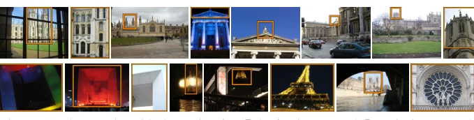
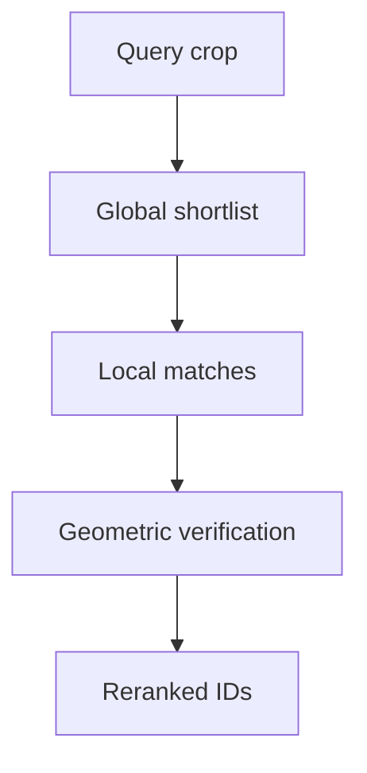

# Revisited Oxford · Truy hồi landmark

Query có hộp giới hạn → thứ hạng gallery ảnh cùng landmark.

**Metric** · mAP ↑ riêng Medium và Hard

**Đề luyện 5 tiếng** · Dùng ROxford5k, giữ query crop, junk và positive theo protocol. Cache gallery một lần. [Dữ liệu và điều kiện truy cập](https://cmp.felk.cvut.cz/revisitop/).

Crop query giúp giảm ảnh hưởng của nền trước khi so với gallery. *Trích Hình 1, landmark query, Radenović và cộng sự.* [PDF gốc, trang 3](https://arxiv.org/pdf/1803.11285#page=3).

## Từ baseline đến mô hình mạnh

1. **Baseline.** Bag of visual words trên SIFT rồi cosine.
2. **Thử nghiệm tiếp theo.** Kiểm tra top 20 cho facade lặp họa tiết. Rerank bằng geometric verification có inlier support.
3. **Kiến trúc nghiên cứu.** DELG kết hợp global retrieval và local descriptors để kiểm chứng hình học.

## Kiến trúc để thử

Khối code có thể tái sử dụng · [Cosine, prototypes và recall theo group ID](../blocks/metrics.py).

## Mốc công bố và hướng SOTA

Bảng 3 DELG tách Medium/Hard, có và không có distractor R1M. Ghi rõ truy hồi global hay có bước local verification. [Thí nghiệm hoặc kiến trúc gốc, tr. 11](https://arxiv.org/pdf/2001.05027#page=11).

R²Former học reranker cùng retrieval features. Đo lại mAP Medium/Hard sau khi giữ nguyên global top-k. [Paper hoặc bảng đối chiếu](https://openaccess.thecvf.com/content/CVPR2023/papers/Zhu_R2Former_Unified_Retrieval_and_Reranking_Transformer_for_Place_Recognition_CVPR_2023_paper.pdf).

[← Trở về danh sách 30 challenge](../README.md)
