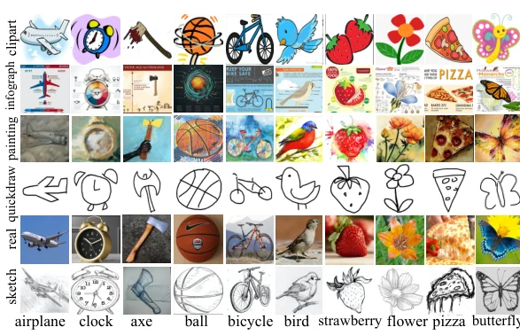
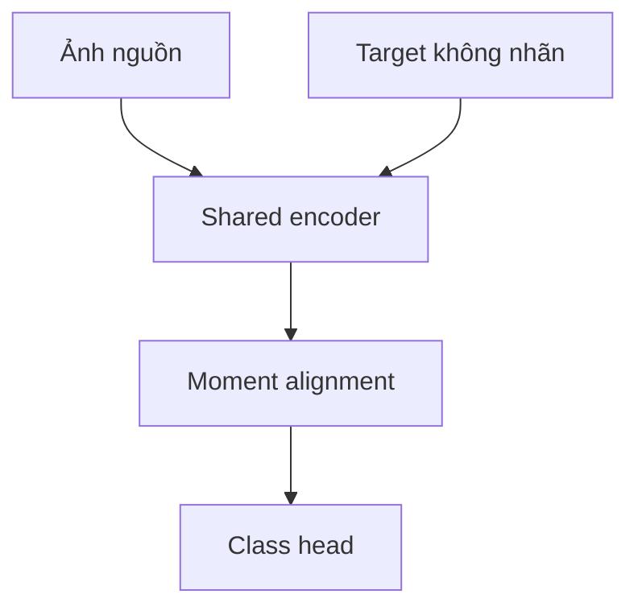

# DomainNet · Chuyển miền ảnh vẽ

Ảnh từ miền nguồn có nhãn, miền đích mới → object class.

**Metric** · Top-1 accuracy miền đích ↑

**Đề luyện 5 tiếng** · Chọn 20 lớp có đủ ở real, painting, sketch, giữ sketch làm target. Trong bài domain generalization không dùng ảnh target train. [Dữ liệu và điều kiện truy cập](https://ai.bu.edu/DomainNet/).

Hình dáng vật giống nhau trong khi texture thay đổi theo miền vẽ. *Trích Hình 1, ví dụ khác miền, Peng và cộng sự.* [PDF gốc, trang 1](https://arxiv.org/pdf/1812.01754#page=1).

## Từ baseline đến mô hình mạnh

1. **Baseline.** ERM linear probe trên feature nguồn đã chuẩn hóa.
2. **Thử nghiệm tiếp theo.** So từng source riêng và pooled. Thử cân bằng batch theo domain, xem lỗi trên sketch có giảm.
3. **Kiến trúc nghiên cứu.** M3SDA khớp moments giữa nhiều nguồn và target không nhãn, chỉ chạy ở biến thể adaptation có target unlabeled.

## Kiến trúc để thử

Khối code có thể tái sử dụng · [Tiền xử lý vector số và metadata chỉ trên train](../blocks/tabular.py).

## Mốc công bố và hướng SOTA

Bảng 5 M3SDA dùng multi-source adaptation với ảnh target không nhãn. Bài held-out domain cần chạy một hàng riêng. [Thí nghiệm hoặc kiến trúc gốc, tr. 8](https://openaccess.thecvf.com/content_ICCV_2019/papers/Peng_Moment_Matching_for_Multi-Source_Domain_Adaptation_ICCV_2019_paper.pdf#page=8).

So hướng adaptation có dữ liệu target không nhãn với kết quả multi-source cùng protocol, ghi rõ quyền truy cập target từ đầu. [Paper hoặc bảng đối chiếu](https://openaccess.thecvf.com/content/ICCV2021/html/Prabhu_SENTRY_Selective_Entropy_Optimization_via_Committee_Consistency_for_Unsupervised_Domain_ICCV_2021_paper.html).

[← Trở về danh sách 30 challenge](../README.md)
