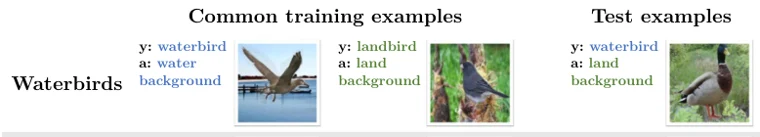
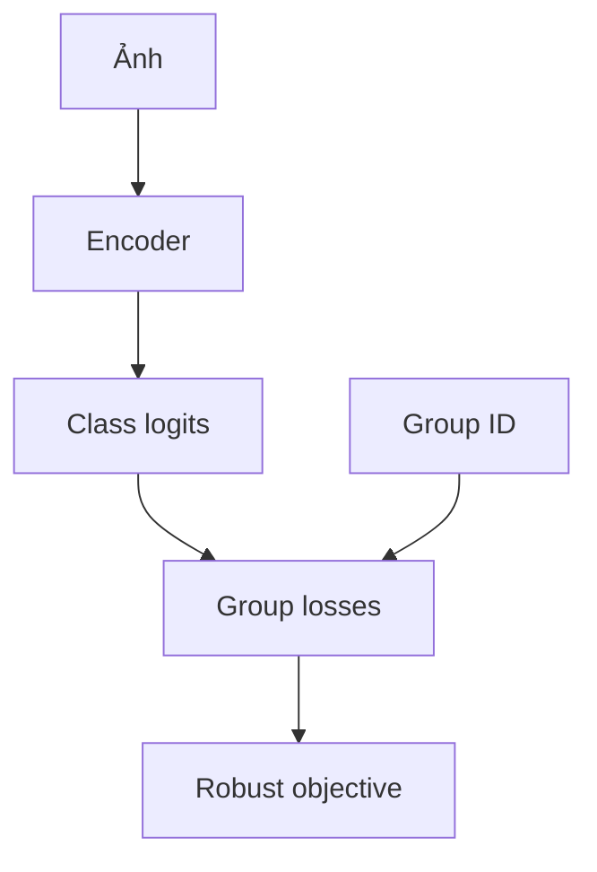

# Waterbirds · Tách loài chim khỏi nền

Ảnh → waterbird/landbird, metadata nền để chấm nhóm.

**Metric** · Worst-group accuracy ↑ trên 4 nhóm

**Đề luyện 5 tiếng** · Giữ split và group IDs chính thức, dùng group label ở train chỉ trong biến thể có supervision nhóm. [Dữ liệu và điều kiện truy cập](https://github.com/kohpangwei/group_DRO).

Tách nhóm chim và môi trường giúp lộ lỗi bị accuracy tổng che khuất. *Trích Hình 1, nhóm có tương quan nền, Sagawa và cộng sự.* [PDF gốc, trang 2](https://arxiv.org/pdf/1911.08731#page=2).

## Từ baseline đến mô hình mạnh

1. **Baseline.** ERM classifier trên feature ảnh.
2. **Thử nghiệm tiếp theo.** So accuracy tổng với nhóm waterbird trên đất. Thử group-balanced sampler, sau đó GroupDRO với cùng feature.
3. **Kiến trúc nghiên cứu.** Group DRO tăng trọng số nhóm có loss cao, regularization quan trọng khi nhóm hiếm ít mẫu.

## Kiến trúc để thử

Khối code có thể tái sử dụng · [Tiền xử lý vector số và metadata chỉ trên train](../blocks/tabular.py).

## Mốc công bố và hướng SOTA

Bảng 2 GroupDRO tách accuracy trung bình và nhóm yếu nhất. Nhãn nhóm và cách đặt group adjustment là điều kiện của từng hàng. [Thí nghiệm hoặc kiến trúc gốc, tr. 7](https://arxiv.org/pdf/1911.08731#page=7).

JTT upweight mẫu mà classifier lần đầu đoán sai. So worst-group accuracy với GroupDRO và ghi nhóm nào cần labels. [Paper hoặc bảng đối chiếu](https://proceedings.mlr.press/v139/liu21f.html).

[← Trở về danh sách 30 challenge](../README.md)
