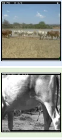
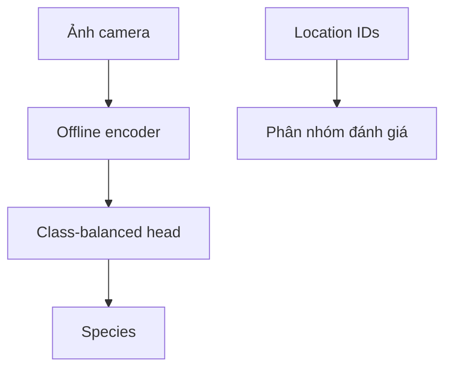

# iWildCam · Phân loại ở camera mới

Ảnh camera trap → species; location là domain.

**Metric** · Macro-F1 ↑ theo WILDS

**Đề luyện 5 tiếng** · Chọn 12 loài, giữ camera location tách biệt theo split WILDS. Báo số loài có mặt ở dev. [Dữ liệu và điều kiện truy cập](https://wilds.stanford.edu/datasets/).

Một domain đại diện location camera; giữ camera đồng nhất khi chia dữ liệu. *Trích Hình 2, cột iWildCam, Koh và cộng sự.* [PDF gốc, trang 2](https://proceedings.mlr.press/v139/koh21a/koh21a.pdf#page=2).

## Từ baseline đến mô hình mạnh

1. **Baseline.** Frozen embedding + logistic class-balanced.
2. **Thử nghiệm tiếp theo.** So macro-F1 camera đã thấy và camera mới, giảm shortcut nền bằng crop quanh animal nếu detector được cấp.
3. **Kiến trúc nghiên cứu.** WILDS đối chiếu ERM và thuật toán thích nghi theo miền, chạy protocol iWildCam với metadata location.

## Kiến trúc để thử

Khối code có thể tái sử dụng · [Tiền xử lý vector số và metadata chỉ trên train](../blocks/tabular.py).

## Mốc công bố và hướng SOTA

Bảng 1 WILDS tách in-distribution và out-of-distribution. Dùng hàng iWildCam và macro-F1, giữ toàn bộ camera test. [Thí nghiệm hoặc kiến trúc gốc, tr. 7](https://proceedings.mlr.press/v139/koh21a/koh21a.pdf#page=7).

Tra bảng OOD của WILDS, chọn đúng metric của dataset và số seed. Bảng tổng hợp của ban tổ chức đã đóng nhận submission. [Paper hoặc bảng đối chiếu](https://wilds.stanford.edu/leaderboard/).

[← Trở về danh sách 30 challenge](../README.md)
