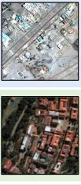
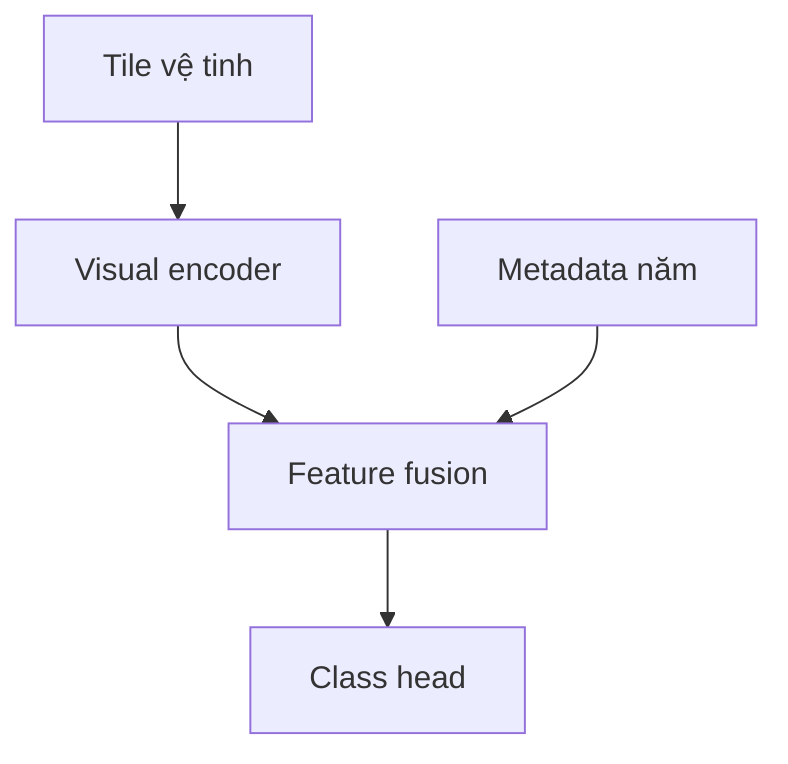

# FMoW-WILDS · Phân loại công trình khi đổi vùng

Tile vệ tinh + năm/vùng → loại công trình.

**Metric** · Worst-region accuracy ↑ cùng average accuracy

**Đề luyện 5 tiếng** · Chọn 10 lớp, giữ official temporal split, report riêng từng vùng. Cache feature ảnh. [Dữ liệu và điều kiện truy cập](https://wilds.stanford.edu/datasets/).

Cột ảnh cùng chỉ một task, cần so theo region và thời điểm chụp. *Trích Hình 2 WILDS, cột FMoW, Koh và cộng sự.* [PDF gốc, trang 2](https://proceedings.mlr.press/v139/koh21a/koh21a.pdf#page=2).

## Từ baseline đến mô hình mạnh

1. **Baseline.** Linear head trên embedding tile.
2. **Thử nghiệm tiếp theo.** Nếu một vùng thấp, so phân bố năm và class, thử balanced minibatch theo vùng và fusion metadata năm.
3. **Kiến trúc nghiên cứu.** WILDS FMoW đánh giá distribution shift theo thời gian/địa lý, dùng group labels đúng chế độ.

## Kiến trúc để thử

Khối code có thể tái sử dụng · [Tiền xử lý vector số và metadata chỉ trên train](../blocks/tabular.py).

## Mốc công bố và hướng SOTA

Bảng 2 WILDS so ERM, CORAL, IRM, GroupDRO theo metric riêng của FMoW, điểm một vùng đơn lẻ không đại diện worst-region nếu thiếu vùng. [Thí nghiệm hoặc kiến trúc gốc, tr. 8](https://proceedings.mlr.press/v139/koh21a/koh21a.pdf#page=8).

Tra bảng OOD của WILDS, chọn đúng metric của dataset và số seed. Bảng tổng hợp của ban tổ chức đã đóng nhận submission. [Paper hoặc bảng đối chiếu](https://wilds.stanford.edu/leaderboard/).

[← Trở về danh sách 30 challenge](../README.md)
