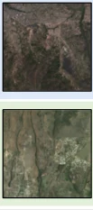
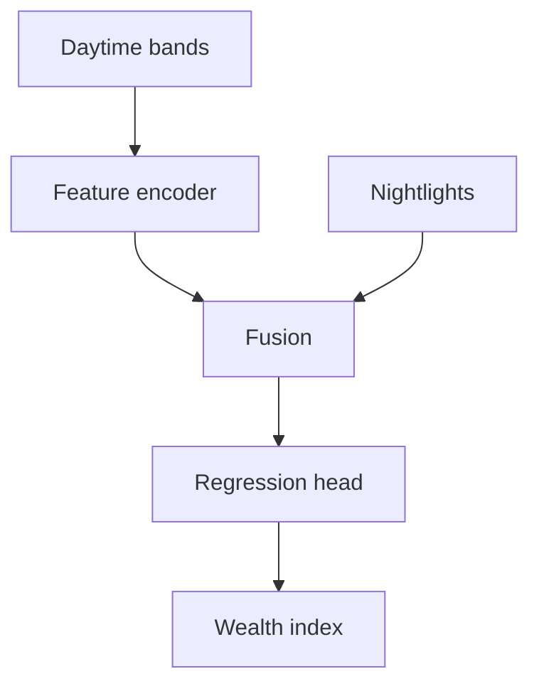

# PovertyMap-WILDS · Hồi quy từ ảnh vệ tinh

Tile đa phổ → wealth index liên tục.

**Metric** · Pearson r ↑, báo r cho urban/rural và nhóm thấp nhất

**Đề luyện 5 tiếng** · Cố định official fold, giữ country split và ID khảo sát. Đánh giá khi có nhiều điểm khác nhau trong mỗi nhóm. [Dữ liệu và điều kiện truy cập](https://wilds.stanford.edu/datasets/).

Khả năng chuyển quốc gia và vùng đô thị/nông thôn đều ảnh hưởng kết quả. *Trích Hình 2 WILDS, cột PovertyMap, Koh và cộng sự.* [PDF gốc, trang 2](https://proceedings.mlr.press/v139/koh21a/koh21a.pdf#page=2).

## Từ baseline đến mô hình mạnh

1. **Baseline.** Ridge trên mean/std từng băng phổ.
2. **Thử nghiệm tiếp theo.** Tách lỗi theo urban/rural, so model chỉ nightlights với daytime + nightlights. Chuẩn hóa feature trên train.
3. **Kiến trúc nghiên cứu.** WILDS PovertyMap đánh giá mô hình CNN đa phổ trên quốc gia mới theo tương quan dự đoán–nhãn.

## Kiến trúc để thử

Khối code có thể tái sử dụng · [Tiền xử lý vector số và metadata chỉ trên train](../blocks/tabular.py).

## Mốc công bố và hướng SOTA

Bảng 2 WILDS báo tương quan nhóm urban/rural yếu hơn, với dữ liệu ngoài phân phối. Phải giữ cùng fold. [Thí nghiệm hoặc kiến trúc gốc, tr. 8](https://proceedings.mlr.press/v139/koh21a/koh21a.pdf#page=8).

Tra bảng OOD của WILDS, chọn đúng metric của dataset và số seed. Bảng tổng hợp của ban tổ chức đã đóng nhận submission. [Paper hoặc bảng đối chiếu](https://wilds.stanford.edu/leaderboard/).

[← Trở về danh sách 30 challenge](../README.md)
