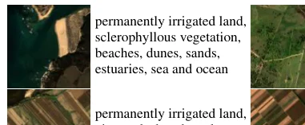
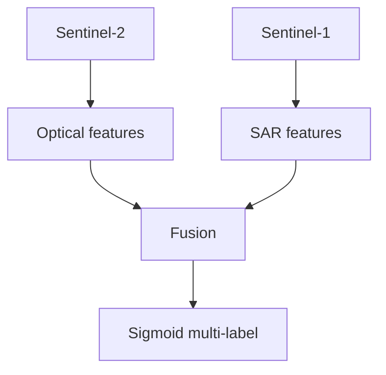

# BigEarthNet · Gán nhiều nhãn lớp phủ

Patch Sentinel-2 nhiều băng → tập nhãn land-cover.

**Metric** · Micro và macro average precision ↑ cho bài luyện

**Đề luyện 5 tiếng** · Chốt BigEarthNet-S2 cùng phiên bản và taxonomy, tách tile địa lý, loại snow/cloud theo danh sách đi kèm. [Dữ liệu và điều kiện truy cập](https://bigearth.net/).

Một tile có thể chứa nhiều kiểu lớp phủ cùng lúc. *Trích Hình 1, mẫu Sentinel-2 đa nhãn, Sumbul và cộng sự.* [PDF gốc, trang 3](https://arxiv.org/pdf/1902.06148#page=3).

## Từ baseline đến mô hình mạnh

1. **Baseline.** One-vs-rest logistic trên thống kê phổ từng kênh.
2. **Thử nghiệm tiếp theo.** Lớp cùng xuất hiện dễ kéo theo false positives. Thêm tỷ số phổ và CNN multi-label, kiểm tra AP từng nhãn.
3. **Kiến trúc nghiên cứu.** BigEarthNet-MM kết hợp Sentinel-1 SAR với Sentinel-2, align kênh và so modality ablation.

## Kiến trúc để thử

Khối code có thể tái sử dụng · [Tiền xử lý vector số và metadata chỉ trên train](../blocks/tabular.py).

## Mốc công bố và hướng SOTA

Bảng II BigEarthNet-MM so tổ hợp cảm biến và nhiều metric multi-label. Phải đối chiếu cùng taxonomy khi dùng phiên bản v2. [Thí nghiệm hoặc kiến trúc gốc, tr. 4](https://arxiv.org/pdf/2105.07921#page=4).

BigEarthNet v2 sửa nhãn và thêm reference maps. Ghi phiên bản trước khi so score hoặc đổi bộ 19/43 nhãn. [Paper hoặc bảng đối chiếu](https://bigearth.net/).

[← Trở về danh sách 30 challenge](../README.md)
