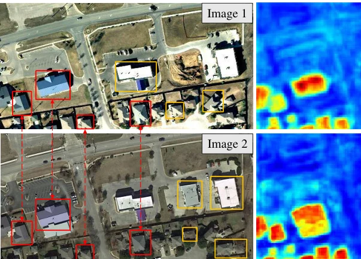
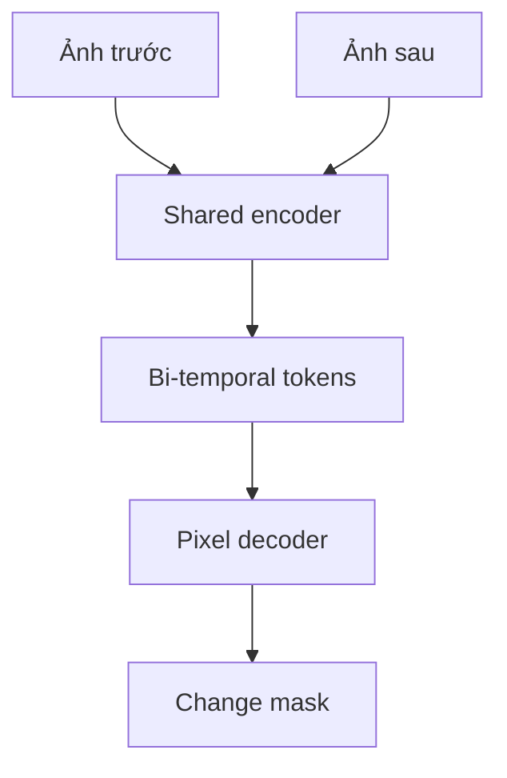

# LEVIR-CD · Tìm tòa nhà thay đổi

Hai ảnh đăng ký cùng khu vực theo hai thời điểm → mask thay đổi.

**Metric** · Foreground F1 và IoU ↑

**Đề luyện 5 tiếng** · Chia theo cặp tile gốc trước khi crop, dùng cùng phép biến đổi hình học cho hai ảnh và mask. [Dữ liệu và điều kiện truy cập](https://justchenhao.github.io/LEVIR/).

Ghép hai thời điểm đúng vị trí rồi so thay đổi cục bộ. *Trích Hình 1 của BIT, Chen, Qi & Shi.* [PDF gốc, trang 2](https://arxiv.org/pdf/2103.00208#page=2).

## Từ baseline đến mô hình mạnh

1. **Baseline.** Lấy trị tuyệt đối hiệu RGB, threshold chọn trên dev.
2. **Thử nghiệm tiếp theo.** Bóng và độ sáng gây false positives. Dùng Siamese encoder chia sẻ trọng số, nối abs-diff nhiều scale vào decoder.
3. **Kiến trúc nghiên cứu.** BIT token hóa feature hai thời điểm, dùng transformer truyền ngữ cảnh rồi đưa trở lại pixel space.

## Kiến trúc để thử

Khối code có thể tái sử dụng · [Ví dụ ghép feature nhiều độ phân giải trước decoder](../../vision/blocks/models.py).

## Mốc công bố và hướng SOTA

Bảng I của BIT báo các chỉ số cho ba dataset change detection, giữ cột LEVIR-CD và lớp foreground. [Thí nghiệm hoặc kiến trúc gốc, tr. 9](https://arxiv.org/pdf/2103.00208#page=9).

ChangeFormer tích hợp Siamese transformer đa tỉ lệ. So gain ở rìa công trình với cùng crop size và split theo tile. [Paper hoặc bảng đối chiếu](https://github.com/wgcban/ChangeFormer/blob/main/README.md?plain=1).

[← Trở về danh sách 30 challenge](../README.md)
