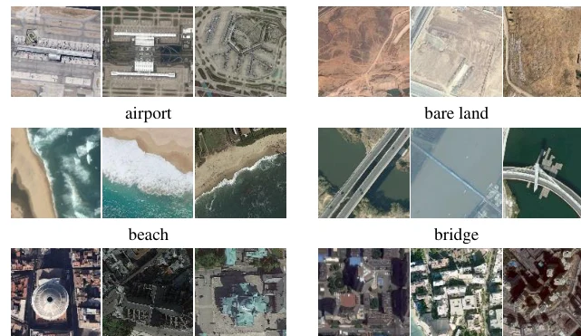
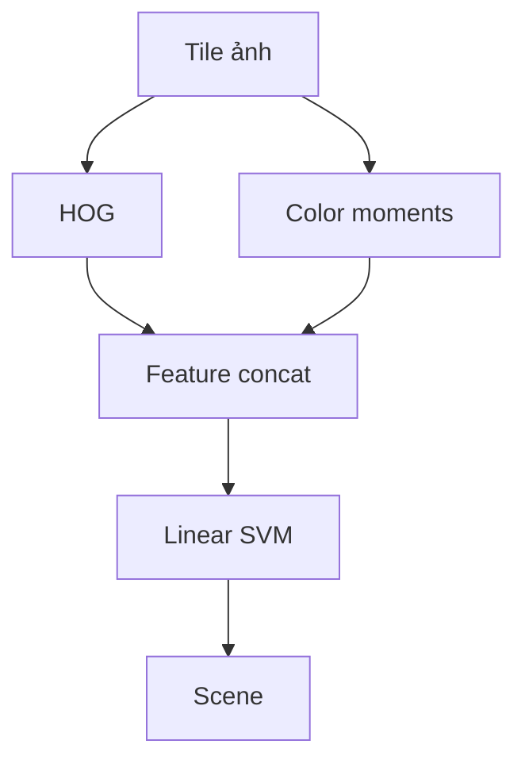

# AID · Scene classification khi ít nhãn

Ảnh trên không → loại khu vực.

**Metric** · Overall accuracy và macro-F1 ↑

**Đề luyện 5 tiếng** · Chọn 10 lớp gần nhau, 20 ảnh train/lớp, lưu seed và ID. Báo mean trên 3 split nếu đủ giờ. [Dữ liệu và điều kiện truy cập](https://captain-whu.github.io/AID/).

Kích thước và bố cục công trình cung cấp tín hiệu ngoài bảng màu. *Trích Hình 1, ví dụ các lớp aerial scene, Xia và cộng sự.* [PDF gốc, trang 8](https://arxiv.org/pdf/1608.05167#page=8).

## Từ baseline đến mô hình mạnh

1. **Baseline.** LBP/HOG + linear SVM.
2. **Thử nghiệm tiếp theo.** Xem confusions giữa school/resort và center/square. Ghép color moments vào HOG rồi so linear probe CNN.
3. **Kiến trúc nghiên cứu.** AID benchmark đối chiếu handcrafted, mid-level và deep features ở nhiều tỉ lệ train, giữ đúng split khi so.

## Kiến trúc để thử

Khối code có thể tái sử dụng · [Tiền xử lý vector số và metadata chỉ trên train](../blocks/tabular.py).

## Mốc công bố và hướng SOTA

Bảng 4 bài AID so representation học sâu theo tỉ lệ train, kết quả 20 ảnh mỗi lớp là giao thức ít nhãn riêng. [Thí nghiệm hoặc kiến trúc gốc, tr. 17](https://arxiv.org/pdf/1608.05167#page=17).

So high-level CNN feature với handcrafted features ở cùng train ratio của AID, chạy nhiều seed để đo độ nhạy của split ít nhãn. [Paper hoặc bảng đối chiếu](https://arxiv.org/abs/1608.05167).

[← Trở về danh sách 30 challenge](../README.md)
