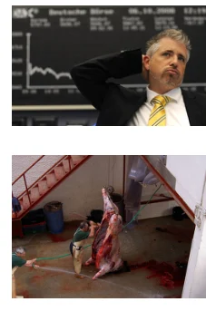
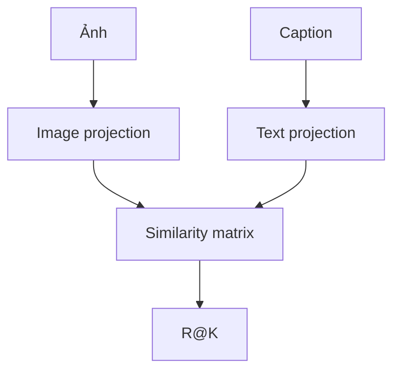

# Flickr30k · Tìm ảnh theo mô tả

Caption → image ID; chiều ngược ảnh → tập caption đúng.

**Metric** · R@1/5/10 ↑ báo tách hai chiều

**Đề luyện 5 tiếng** · Tách theo image ID với tất cả captions đi cùng, tính trên toàn gallery đã chốt, ghi kích thước. [Dữ liệu và điều kiện truy cập](https://shannon.cs.illinois.edu/DenotationGraph/data/).

Mỗi ảnh có nhiều cách mô tả, nên dùng image ID để xác định positive. *Trích Hình 1, hai ảnh ví dụ, Young và cộng sự.* [PDF gốc, trang 2](https://aclanthology.org/Q14-1006.pdf#page=2).

## Từ baseline đến mô hình mạnh

1. **Baseline.** Cosine giữa image/text features từ encoder ghép cặp đã cache, nếu chưa có thì ridge text→features trên train.
2. **Thử nghiệm tiếp theo.** Đếm false negatives do nhiều caption của cùng ảnh. Dùng multi-positive contrastive loss trước hard-negative mining.
3. **Kiến trúc nghiên cứu.** VSE++ tối ưu bằng hard negatives trong batch, đo cả hai hướng trên cùng test pool.

## Kiến trúc để thử

Khối code có thể tái sử dụng · [Train và chấm retrieval hai chiều có nhiều positive](../retrieve.py).

## Mốc công bố và hướng SOTA

Bảng 3 VSE++ so hai chiều trên Flickr30k. Hard negative phụ thuộc kích thước batch và cách lấy captions. [Thí nghiệm hoặc kiến trúc gốc, tr. 8](https://arxiv.org/pdf/1707.05612#page=8).

BLIP dùng cả image–text contrastive và matching. Chiếu lại top-k bằng matching head giúp kiểm tra lợi ích của reranking. [Paper hoặc bảng đối chiếu](https://proceedings.mlr.press/v162/li22n).

[← Trở về danh sách 30 challenge](../README.md)
