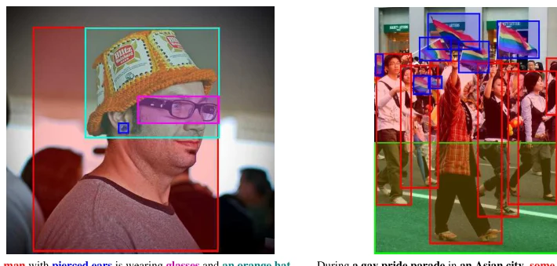
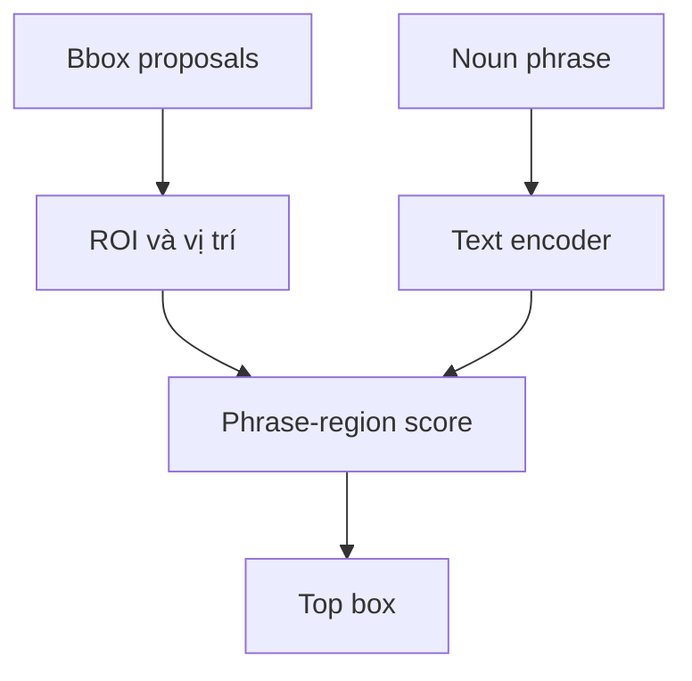

# Flickr30k Entities · Ground phrase vào box

Ảnh, noun phrase và candidate boxes → box khớp phrase.

**Metric** · Recall@1/5 ↑ với IoU ≥0.5

**Đề luyện 5 tiếng** · Chọn 2.000 ảnh, giữ đủ phrase và box, khai báo proposals lấy từ detector hay annotations. [Dữ liệu và điều kiện truy cập](https://github.com/BryanPlummer/flickr30k_entities).

Một danh từ trong câu có thể quy chiếu đến một hoặc nhiều vùng. *Trích Hình 1, phrase–region annotations, Plummer và cộng sự.* [PDF gốc, trang 2](https://openaccess.thecvf.com/content_iccv_2015/papers/Plummer_Flickr30k_Entities_Collecting_ICCV_2015_paper.pdf#page=2).

## Từ baseline đến mô hình mạnh

1. **Baseline.** Chọn proposal lớn nhất, rồi score ROI feature với embedding phrase.
2. **Thử nghiệm tiếp theo.** Đo oracle proposal recall. Khi box đúng có trong pool, thêm feature vị trí để tách “man on the left”.
3. **Kiến trúc nghiên cứu.** MAttNet phân rã mô tả thành subject/location/relationship, thử module location trên pool Flickr30k.

## Kiến trúc để thử

Khối code có thể tái sử dụng · [Hai cách fusion bằng projection hoặc attention trên vùng](../blocks/fusion.py).

## Mốc công bố và hướng SOTA

Bảng 1 MAttNet là grounding trên họ RefCOCO. Đối chiếu trực tiếp Flickr30k ở paper Entities và dùng cùng candidate boxes. [Thí nghiệm hoặc kiến trúc gốc, tr. 6](https://openaccess.thecvf.com/content_cvpr_2018/papers/Yu_MAttNet_Modular_Attention_CVPR_2018_paper.pdf#page=6).

MDETR ground phrase trực tiếp bằng detector điều kiện hóa theo câu. Giữ cùng tiêu chuẩn IoU với proposal-ranking baseline. [Paper hoặc bảng đối chiếu](https://openaccess.thecvf.com/content/ICCV2021/html/Kamath_MDETR_-_Modulated_Detection_for_End-to-End_Multi-Modal_Understanding_ICCV_2021_paper.html).

[← Trở về danh sách 30 challenge](../README.md)
