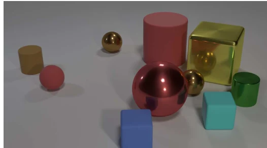
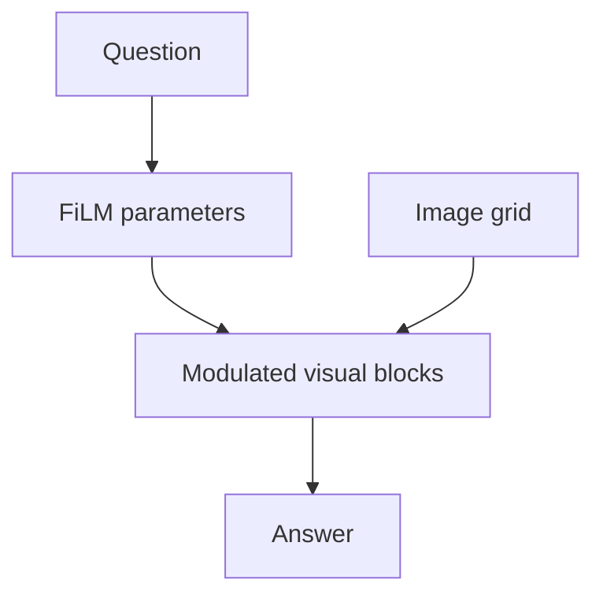

# CLEVR · Suy luận quan hệ và đếm

Ảnh hình khối + câu hỏi → đáp án rời rạc.

**Metric** · Accuracy ↑ theo count, compare, exist, query

**Đề luyện 5 tiếng** · Chọn 5.000 câu nhưng tách theo scene. Giữ question program chỉ để phân nhóm lỗi hoặc oracle đã khai báo. [Dữ liệu và điều kiện truy cập](https://cs.stanford.edu/people/jcjohns/clevr/).

Cùng tập vật thể có thể sinh câu hỏi màu sắc, số lượng hoặc quan hệ. *Trích Hình 1, scene mẫu, Johnson và cộng sự.* [PDF gốc, trang 1](https://openaccess.thecvf.com/content_cvpr_2017/papers/Johnson_CLEVR_A_Diagnostic_CVPR_2017_paper.pdf#page=1).

## Từ baseline đến mô hình mạnh

1. **Baseline.** Bag-of-words question + global RGB feature + MLP.
2. **Thử nghiệm tiếp theo.** Question-only có thể đoán đúng theo prior. Thay global pool bằng lưới feature có tọa độ và attention theo câu.
3. **Kiến trúc nghiên cứu.** FiLM cho câu hỏi điều khiển scale/shift của từng kênh visual feature qua nhiều reasoning blocks.

## Kiến trúc để thử

Khối code có thể tái sử dụng · [Hai cách fusion bằng projection hoặc attention trên vùng](../blocks/fusion.py).

## Mốc công bố và hướng SOTA

Bảng 1, CNN + GRU + FiLM đạt 97,7% overall và 94,3% ở câu đếm trên CLEVR. Xem nhóm câu để quyết định module cần đổi. [Thí nghiệm hoặc kiến trúc gốc, tr. 4](https://arxiv.org/pdf/1709.07871#page=4).

MAC thực hiện nhiều bước đọc và cập nhật memory theo câu. Xem riêng câu quan hệ nhiều bước ngoài overall accuracy. [Paper hoặc bảng đối chiếu](https://arxiv.org/abs/1803.03067).

[← Trở về danh sách 30 challenge](../README.md)
