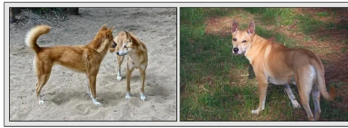
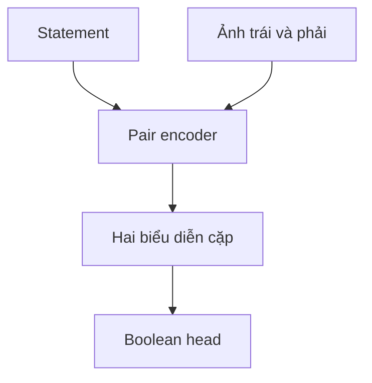

# NLVR2 · Kiểm tra mệnh đề trên hai ảnh

Hai ảnh + câu trần thuật → đúng/sai.

**Metric** · Accuracy và consistency theo statement ↑

**Đề luyện 5 tiếng** · Giữ tất cả cặp ảnh ứng với cùng statement trong một split. Cache hai embedding riêng. [Dữ liệu và điều kiện truy cập](https://lil.nlp.cornell.edu/nlvr/).

Giữ cấu trúc cặp ảnh để suy ra giá trị đúng/sai. *Trích Hình 1, cặp ảnh của một statement, Suhr và cộng sự.* [PDF gốc, trang 1](https://aclanthology.org/P19-1644.pdf#page=1).

## Từ baseline đến mô hình mạnh

1. **Baseline.** Nối hai image embeddings với sentence embedding → logistic/MLP.
2. **Thử nghiệm tiếp theo.** Hoán đổi hai ảnh để kiểm tra trái/phải. Thêm interaction giữa từng ảnh và câu trước khi ghép hai kết quả.
3. **Kiến trúc nghiên cứu.** ViLT dùng transformer chung cho token ảnh/văn bản, có benchmark NLVR2, xử lý riêng vai trò từng ảnh.

## Kiến trúc để thử

Khối code có thể tái sử dụng · [Hai cách fusion bằng projection hoặc attention trên vùng](../blocks/fusion.py).

## Mốc công bố và hướng SOTA

Bảng 2 ViLT-B/32 ghi NLVR2 dev và test-P, so accuracy cùng split và ghi riêng consistency. [Thí nghiệm hoặc kiến trúc gốc, tr. 6](https://arxiv.org/pdf/2102.03334#page=6).

ALBEF align image/text representations trước fusion. Đo consistency theo nhóm statement khi thêm interaction giữa hai ảnh. [Paper hoặc bảng đối chiếu](https://github.com/salesforce/ALBEF/blob/main/README.md).

[← Trở về danh sách 30 challenge](../README.md)
