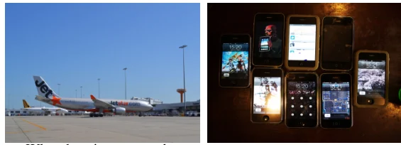
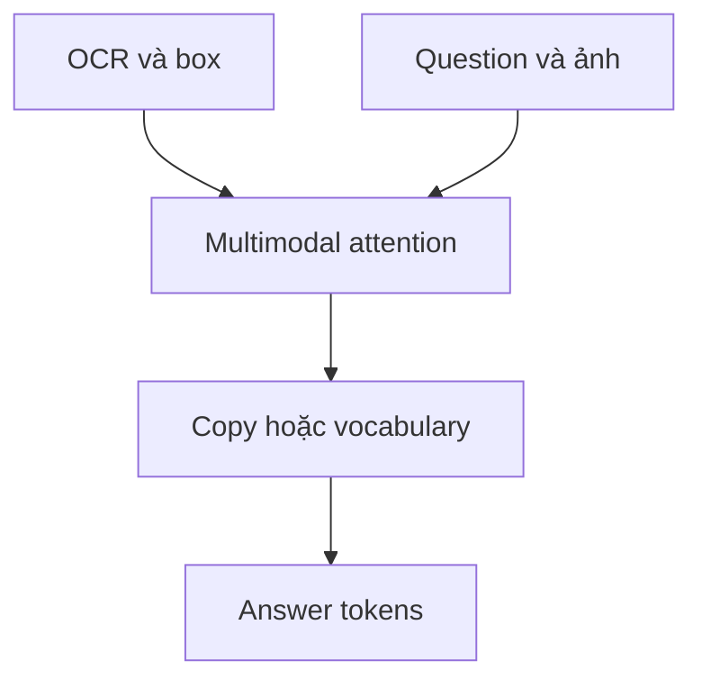

# TextVQA · Đọc chữ để trả lời ảnh

Ảnh + question + OCR tokens → đáp án ngắn.

**Metric** · VQA soft accuracy ↑ theo evaluator

**Đề luyện 5 tiếng** · Chọn 2.000 ảnh, dùng OCR offline sẵn có, giữ nhiều human answers khi chấm. [Dữ liệu và điều kiện truy cập](https://textvqa.org/).

Kiểm tra answer có xuất hiện trong OCR trước khi quy lỗi cho reasoning. *Trích Hình 1, hai ảnh cần đọc chữ, Singh và cộng sự.* [PDF gốc, trang 1](https://openaccess.thecvf.com/content_CVPR_2019/papers/Singh_Towards_VQA_Models_That_Can_Read_CVPR_2019_paper.pdf#page=1).

## Từ baseline đến mô hình mạnh

1. **Baseline.** Chọn OCR word gần từ khóa nhất hoặc answer prior khi không có OCR.
2. **Thử nghiệm tiếp theo.** Đo oracle tỷ lệ answer xuất hiện trong OCR. Thêm embedding bbox và copy head để sinh từ hiếm.
3. **Kiến trúc nghiên cứu.** M4C kết hợp OCR, ảnh, câu hỏi trong multimodal transformer và copy token qua nhiều bước.

## Kiến trúc để thử

Khối code có thể tái sử dụng · [Hai cách fusion bằng projection hoặc attention trên vùng](../blocks/fusion.py).

## Mốc công bố và hướng SOTA

Bảng 1 M4C ablate dùng OCR, cách biểu diễn OCR và prediction head. Đo oracle answer-in-OCR trước khi so end-to-end. [Thí nghiệm hoặc kiến trúc gốc, tr. 6](https://arxiv.org/pdf/1911.06258#page=6).

TAP bổ sung pretraining gắn token OCR với thông tin ảnh. Thử cùng bộ OCR để tách gain của encoder khỏi chất lượng nhận chữ. [Paper hoặc bảng đối chiếu](https://openaccess.thecvf.com/content/CVPR2021/html/Yang_TAP_Text-Aware_Pre-Training_for_Text-VQA_and_Text-Caption_CVPR_2021_paper.html).

[← Trở về danh sách 30 challenge](../README.md)
