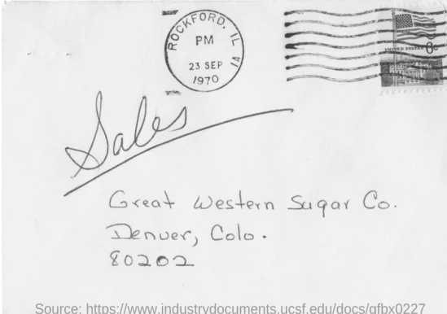
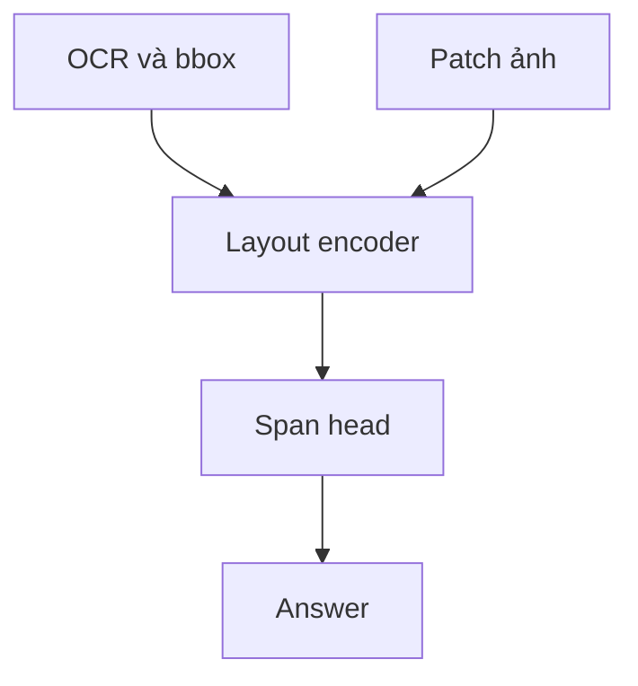

# DocVQA · Trả lời trên tài liệu scan

Ảnh tài liệu + câu hỏi + OCR → chuỗi trả lời.

**Metric** · ANLS ↑ theo scorer DocVQA

**Đề luyện 5 tiếng** · Chọn 1.500 câu của single-page DocVQA, tách theo document. Cache word boxes + text. [Dữ liệu và điều kiện truy cập](https://www.docvqa.org/datasets/docvqa).

Tọa độ dòng OCR giúp phân biệt hai trường có từ khóa gần nhau. *Trích Hình 1, ví dụ document scan, Mathew, Karatzas & Jawahar.* [PDF gốc, trang 1](https://arxiv.org/pdf/2007.00398#page=1).

## Từ baseline đến mô hình mạnh

1. **Baseline.** Tìm dòng chứa từ khóa và lấy text bên phải.
2. **Thử nghiệm tiếp theo.** Chia lỗi thành OCR sai hoặc chọn sai dòng. Với OCR đúng, thêm đặc trưng x/y và học score cho span.
3. **Kiến trúc nghiên cứu.** LayoutLMv3 kết hợp token, vị trí và patch ảnh, có thực nghiệm DocVQA.

## Kiến trúc để thử

Khối code có thể tái sử dụng · [Hai cách fusion bằng projection hoặc attention trên vùng](../blocks/fusion.py).

## Mốc công bố và hướng SOTA

Bảng 1 LayoutLMv3 báo DocVQA cùng các task tài liệu khác. Đọc cột DocVQA theo ANLS. [Thí nghiệm hoặc kiến trúc gốc, tr. 5](https://arxiv.org/pdf/2204.08387#page=5).

Donut đọc document pixels và sinh câu trả lời. So ANLS và latency với LayoutLMv3 trên cùng danh sách câu hỏi. [Paper hoặc bảng đối chiếu](https://www.ecva.net/papers/eccv_2022/papers_ECCV/papers/136880493.pdf).

[← Trở về danh sách 30 challenge](../README.md)
