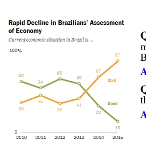
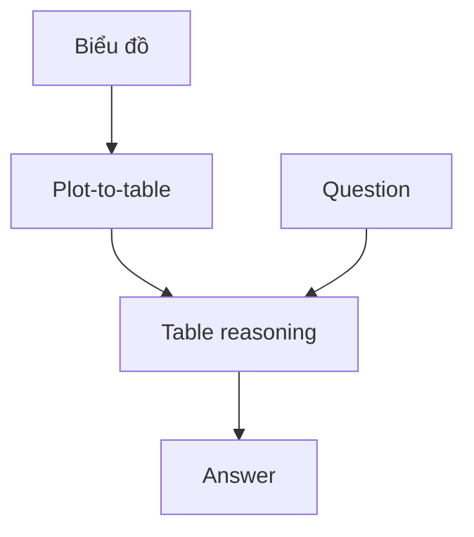

# ChartQA · Đọc biểu đồ và tính toán

Biểu đồ + câu hỏi → số hoặc chuỗi.

**Metric** · Relaxed accuracy ↑ theo evaluator ChartQA, tách human và augmented

**Đề luyện 5 tiếng** · Chọn 1.000 chart, tách theo chart ID. Thử hai track có bảng đi kèm và image-only, báo tách. [Dữ liệu và điều kiện truy cập](https://github.com/vis-nlp/ChartQA).

Đọc đúng series và trục là bước riêng trước phép tính hiệu hoặc tỉ lệ. *Trích Hình 1, chart ở đầu ví dụ, Masry và cộng sự.* [PDF gốc, trang 1](https://aclanthology.org/2022.findings-acl.177.pdf#page=1).

## Từ baseline đến mô hình mạnh

1. **Baseline.** Khi có bảng, match tên series/category và tra ô. Với image-only, thay bảng bằng OCR + vị trí.
2. **Thử nghiệm tiếp theo.** Chấm riêng lookup, difference, ratio. Nếu nhận đúng ô nhưng sai số, thêm parser phép toán thay vì đổi encoder.
3. **Kiến trúc nghiên cứu.** DePlot dịch chart thành bảng, sau đó reasoning trên các ô, so oracle-table với bảng suy từ ảnh.

## Kiến trúc để thử

Khối code có thể tái sử dụng · [Hai cách fusion bằng projection hoặc attention trên vùng](../blocks/fusion.py).

## Mốc công bố và hướng SOTA

Bảng 5 DePlot tách ChartQA human và augmented, so loại prompts và LLM. Bảng 4 chấm riêng bước dịch chart thành bảng. [Thí nghiệm hoặc kiến trúc gốc, tr. 7](https://arxiv.org/pdf/2212.10505#page=7).

MatCha pretrain bằng chart derendering và toán học. So human/augmented để xem gain đến từ đọc chart hay reasoning. [Paper hoặc bảng đối chiếu](https://aclanthology.org/2023.acl-long.714/).

[← Trở về danh sách 30 challenge](../README.md)
