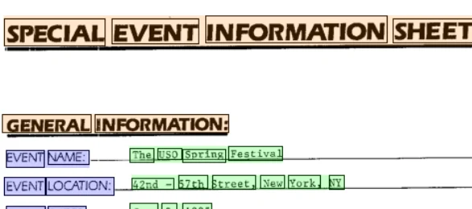
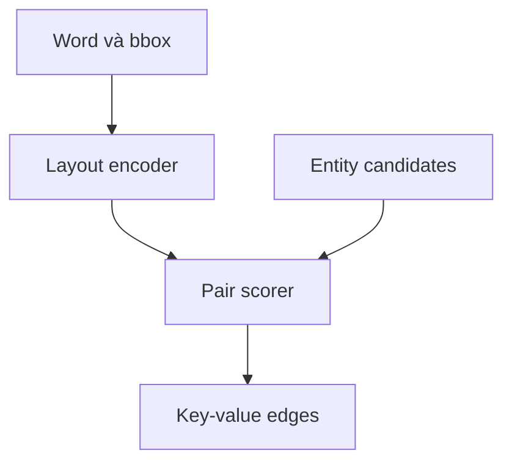

# FUNSD · Liên kết key và value

Word text + bbox trên form → cạnh question–answer.

**Metric** · Micro-F1 trên cạnh ↑ ở bài luyện với entity vàng

**Đề luyện 5 tiếng** · Dùng official document split, giữ entity ID theo từng trang. Khai báo đầu vào có entity vàng. [Dữ liệu và điều kiện truy cập](https://guillaumejaume.github.io/FUNSD/).

Vị trí hai trường tạo tín hiệu để gán một cạnh question–answer. *Trích Hình 2, key và value, Jaume, Ekenel & Thiran.* [PDF gốc, trang 4](https://arxiv.org/pdf/1905.13538#page=4).

## Từ baseline đến mô hình mạnh

1. **Baseline.** Mỗi key nối value gần nhất phía phải hoặc phía dưới.
2. **Thử nghiệm tiếp theo.** Đếm lỗi khi hai vùng nằm cùng hàng. Thêm feature dx, dy, độ chồng hàng và train pair classifier trên hard negatives.
3. **Kiến trúc nghiên cứu.** LayoutXLM công bố entity linking trên XFUND, dùng ý tưởng layout-aware representation chuyển sang FUNSD.

## Kiến trúc để thử

Khối code có thể tái sử dụng · [Hai cách fusion bằng projection hoặc attention trên vùng](../blocks/fusion.py).

## Mốc công bố và hướng SOTA

Bảng 2 LayoutXLM là XFUND. Khi chuyển sang FUNSD entity linking, công bố entity vàng hay entity do model dự đoán. [Thí nghiệm hoặc kiến trúc gốc, tr. 7](https://arxiv.org/pdf/2104.08836#page=7).

FormNet dùng cấu trúc cục bộ của form cho thông tin trường. Entity labeling và entity linking cần báo F1 riêng. [Paper hoặc bảng đối chiếu](https://aclanthology.org/2022.acl-long.260/).

[← Trở về danh sách 30 challenge](../README.md)
