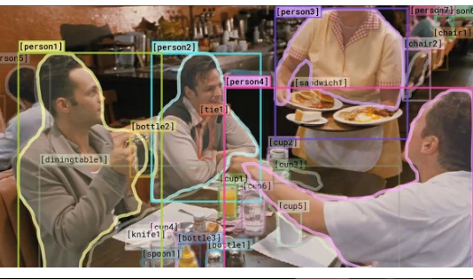
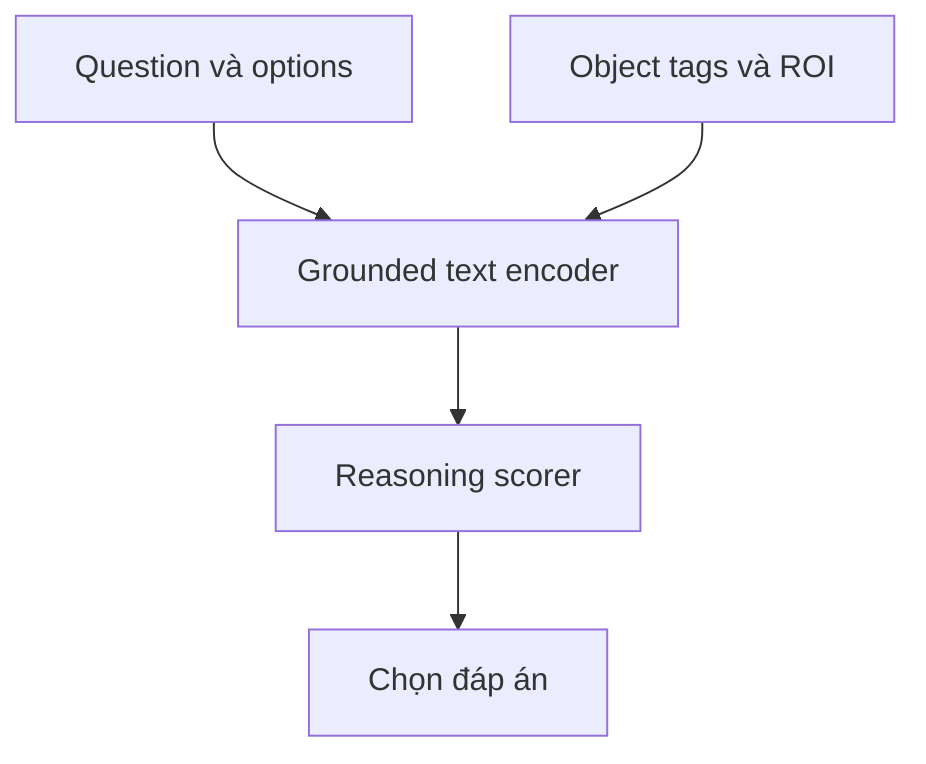

# VCR · Chọn đáp án có căn cứ trực quan

Ảnh, object tags, câu hỏi và 4 đáp án → một index.

**Metric** · Q→A accuracy ↑, rationale là task riêng

**Đề luyện 5 tiếng** · Luyện Q→A trên 2.000 câu, group theo movie, giữ ánh xạ tag đối tượng tới ROI. [Dữ liệu và điều kiện truy cập](https://visualcommonsense.com/).

Tag người trong câu phải trỏ đến đúng ROI trong ảnh. *Trích Hình 1, vùng đối tượng, Zellers và cộng sự.* [PDF gốc, trang 1](https://openaccess.thecvf.com/content_CVPR_2019/papers/Zellers_From_Recognition_to_Cognition_Visual_Commonsense_Reasoning_CVPR_2019_paper.pdf#page=1).

## Từ baseline đến mô hình mạnh

1. **Baseline.** Text-only ranker dùng cùng trọng số để chấm 4 phương án.
2. **Thử nghiệm tiếp theo.** Hoán vị ROI giữa hai người cùng giới rồi đo accuracy. Thêm vùng đã tham chiếu thay vì global embedding.
3. **Kiến trúc nghiên cứu.** R2C contextualizes các object tags và dùng reasoning network để chấm đáp án cùng grounding.

## Kiến trúc để thử

Khối code có thể tái sử dụng · [Hai cách fusion bằng projection hoặc attention trên vùng](../blocks/fusion.py).

## Mốc công bố và hướng SOTA

Bảng 1 R2C tách Q→A, QA→R và Q→AR. Bài luyện chọn Q→A để giữ chi phí trong buổi thi. [Thí nghiệm hoặc kiến trúc gốc, tr. 6](https://openaccess.thecvf.com/content_CVPR_2019/papers/Zellers_From_Recognition_to_Cognition_Visual_Commonsense_Reasoning_CVPR_2019_paper.pdf#page=6).

UNITER thêm cross-modal pretraining. Tách Q→A khỏi rationale và giữ cùng nguồn ROI khi so với R2C. [Paper hoặc bảng đối chiếu](https://www.ecva.net/papers/eccv_2020/papers_ECCV/papers/123750103.pdf).

[← Trở về danh sách 30 challenge](../README.md)
