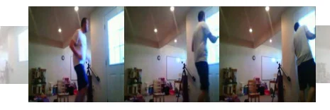
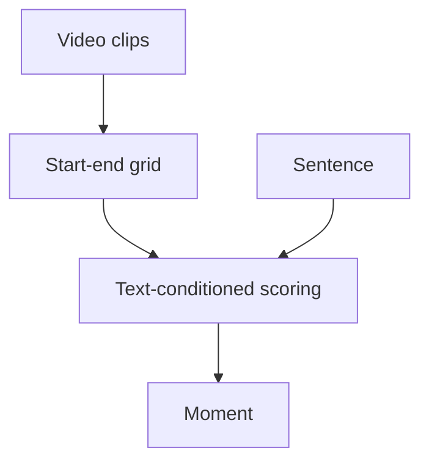

# Charades-STA · Tìm khoảng thời gian theo câu

Video + câu mô tả → thời điểm bắt đầu/kết thúc.

**Metric** · R@1 tại tIoU 0.5 và 0.7 ↑

**Đề luyện 5 tiếng** · Tách theo video, cache 16 hoặc 32 clip embeddings/video, lưu giây cho từng bin. [Dữ liệu và điều kiện truy cập](https://github.com/jiyanggao/TALL).

Cần dự đoán hai biên của hành động, kể cả khi ngữ nghĩa clip đã đúng. *Trích Hình 1, khoảng thời gian theo mô tả, Gao và cộng sự.* [PDF gốc, trang 1](https://storage.googleapis.com/lacuna-pdfs-lunar-airport-385023/pdfs/20/eb/20eb5510cd4aab518fa314e5780323d764eaff5ab5c355804a71eb4fe8175d84.pdf#page=1).

## Từ baseline đến mô hình mạnh

1. **Baseline.** Sliding windows vài độ dài, cosine text với mean clip feature.
2. **Thử nghiệm tiếp theo.** Đo oracle của window grid. Thêm head offset cho biên thay vì tăng số proposal khi recall cao.
3. **Kiến trúc nghiên cứu.** 2D-TAN biểu diễn start × end trên lưới tam giác và gộp thông tin giữa proposal lân cận.

## Kiến trúc để thử

Khối code có thể tái sử dụng · [Hai cách fusion bằng projection hoặc attention trên vùng](../blocks/fusion.py).

## Mốc công bố và hướng SOTA

Bảng 1 2D-TAN báo Charades-STA. So R@1 tại cùng tIoU và cùng visual features. [Thí nghiệm hoặc kiến trúc gốc, tr. 6](https://arxiv.org/pdf/1912.03590#page=6).

Đọc mô hình two-stage moment retrieval trong paper ICCV 2025, so chất lượng proposals trước và sau reranking theo tIoU. [Paper hoặc bảng đối chiếu](https://openaccess.thecvf.com/content/ICCV2025/papers/Wei_Augmenting_Moment_Retrieval_Zero-Dependency_Two-Stage_Learning_ICCV_2025_paper.pdf).

[← Trở về danh sách 30 challenge](../README.md)
