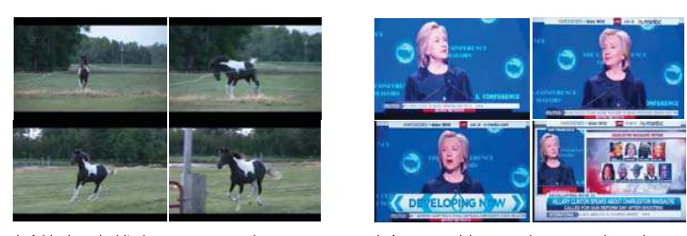
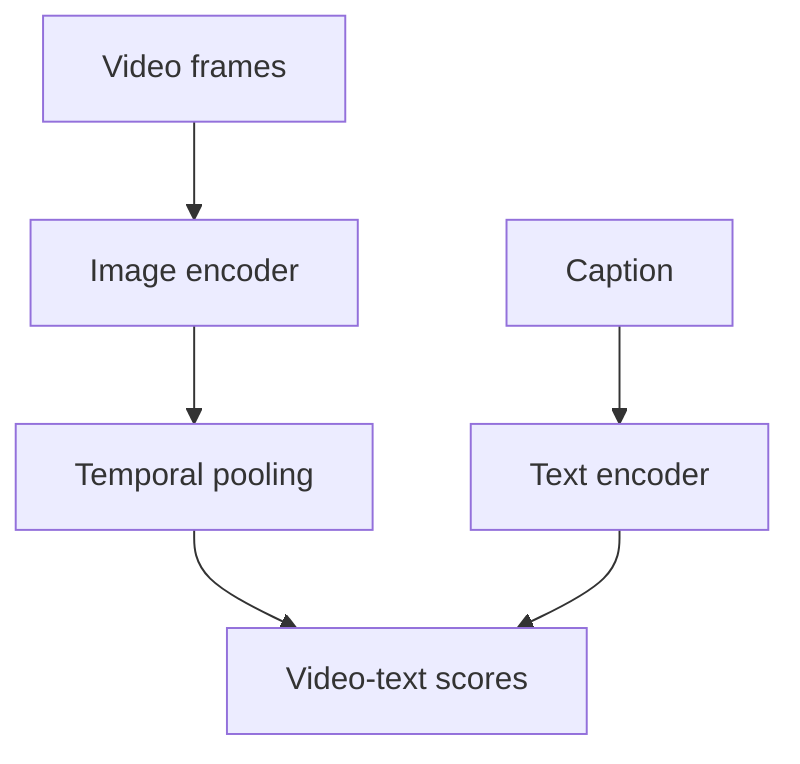

# MSR-VTT · Tìm video từ mô tả

Caption → xếp hạng video ID.

**Metric** · Text-to-video Recall@1/5/10 ↑

**Đề luyện 5 tiếng** · Dùng một protocol cố định như 1k-A nếu có danh sách ID, khi rút gọn phải ghi gallery size. Cache 8 frame/clip. [Dữ liệu và điều kiện truy cập](https://www.microsoft.com/en-us/research/publication/msr-vtt-a-large-video-description-dataset-for-bridging-video-and-language/).

Cache nhiều frame để giữ thông tin biến đổi theo thời gian. *Trích Hình 1, một số clip, Xu và cộng sự.* [PDF gốc, trang 2](https://openaccess.thecvf.com/content_cvpr_2016/papers/Xu_MSR-VTT_A_Large_CVPR_2016_paper.pdf#page=2).

## Từ baseline đến mô hình mạnh

1. **Baseline.** Mean frame embedding → chuẩn hóa → cosine với caption.
2. **Thử nghiệm tiếp theo.** Chia caption theo vật thể và động từ. Thử temporal pooling học được rồi hard negative cùng danh từ.
3. **Kiến trúc nghiên cứu.** CLIP4Clip so nhiều cách tổng hợp temporal feature trên cùng CLIP, chọn mean pooling làm mốc.

## Kiến trúc để thử

Khối code có thể tái sử dụng · [Train và chấm retrieval hai chiều có nhiều positive](../retrieve.py).

## Mốc công bố và hướng SOTA

Bảng 1 CLIP4Clip báo nhiều protocol MSR-VTT. Ghi rõ gallery 1k và split A/B trước khi so R@1. [Thí nghiệm hoặc kiến trúc gốc, tr. 6](https://arxiv.org/pdf/2104.08860#page=6).

X-CLIP dùng tương tác nhiều cấp giữa video và caption. So R@1 sau khi cố định số frame và 1k test split. [Paper hoặc bảng đối chiếu](https://arxiv.org/abs/2207.07285).

[← Trở về danh sách 30 challenge](../README.md)
