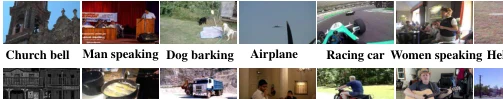
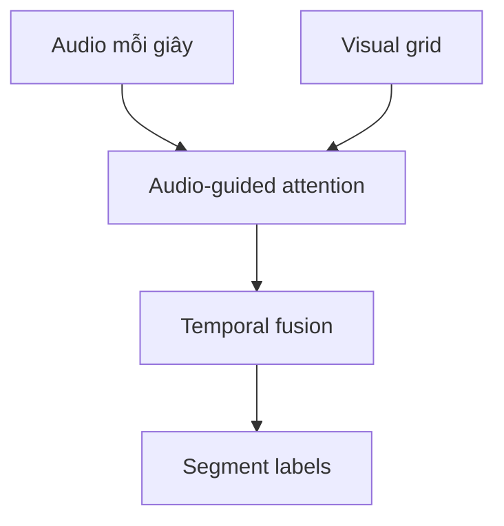

# AVE · Định vị sự kiện nghe và thấy

Đặc trưng audio/video theo từng giây → nhãn sự kiện hoặc nền mỗi giây.

**Metric** · Segment accuracy ↑ ở supervised setting

**Đề luyện 5 tiếng** · Dùng feature phát hành theo cửa sổ 1 giây, tách theo video, giữ đúng alignment khi lấy crop thời gian. [Dữ liệu và điều kiện truy cập](https://github.com/YapengTian/AVE-ECCV18).

Một segment được coi là sự kiện khi thông tin nghe và thấy phù hợp. *Trích Hình 2, một số frame của AVE, Tian và cộng sự.* [PDF gốc, trang 5](https://www.ecva.net/papers/eccv_2018/papers_ECCV/papers/Yapeng_Tian_Audio-Visual_Event_Localization_ECCV_2018_paper.pdf#page=5).

## Từ baseline đến mô hình mạnh

1. **Baseline.** Hai linear classifiers theo giây → average logits.
2. **Thử nghiệm tiếp theo.** Tắt lần lượt audio/video. Nếu audio đúng nhưng cụm thời gian lệch, thêm temporal convolution sau fusion.
3. **Kiến trúc nghiên cứu.** Audio-Visual Event Localization dùng audio-guided visual attention và mô hình chuỗi cho segment labels.

## Kiến trúc để thử

Khối code có thể tái sử dụng · [Hai cách fusion bằng projection hoặc attention trên vùng](../blocks/fusion.py).

## Mốc công bố và hướng SOTA

Bảng 1 AVE đánh giá supervised segment localization, weak supervision và cross-modal localization có thí nghiệm riêng. [Thí nghiệm hoặc kiến trúc gốc, tr. 12](https://arxiv.org/pdf/1803.08842#page=12).

So attention một chiều với attention từ hai modality. Giữ nhãn và độ dài temporal segment khi so supervised AVE. [Paper hoặc bảng đối chiếu](https://openaccess.thecvf.com/content_ICCV_2019/papers/Wu_Dual_Attention_Matching_for_Audio-Visual_Event_Localization_ICCV_2019_paper.pdf).

[← Trở về danh sách 30 challenge](../README.md)
