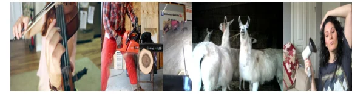
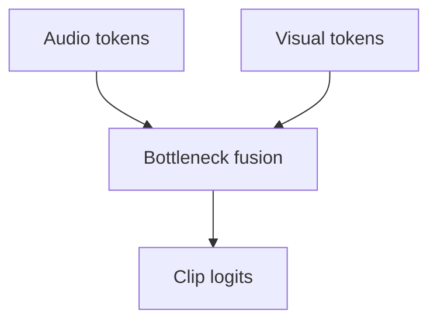

# VGGSound · Nhận dạng sự kiện audio-visual

Clip có hình và tiếng → lớp sự kiện.

**Metric** · Top-1 và top-5 accuracy ↑

**Đề luyện 5 tiếng** · Chọn 10 lớp có clip local hoặc features được phép, split theo YouTube ID. Cân bằng duration/sampling rate. [Dữ liệu và điều kiện truy cập](https://www.robots.ox.ac.uk/~vgg/data/vggsound/).

Chọn split theo video nguồn trước khi cắt các đoạn audio. *Trích Hình 1, video frames, Chen và cộng sự.* [PDF gốc, trang 3](https://arxiv.org/pdf/2004.14368#page=3).

## Từ baseline đến mô hình mạnh

1. **Baseline.** Log-mel mean/std → linear head, so với chỉ RGB embedding.
2. **Thử nghiệm tiếp theo.** Đo gain của late fusion khi tắt một modality. Dùng modality dropout nếu một nhánh quá lấn át.
3. **Kiến trúc nghiên cứu.** MBT trao đổi thông tin qua số ít bottleneck tokens để giảm chi phí cross-modal attention, kiểm tra lại trên subset.

## Kiến trúc để thử

Khối code có thể tái sử dụng · [Hai cách fusion bằng projection hoặc attention trên vùng](../blocks/fusion.py).

## Mốc công bố và hướng SOTA

Bảng 3 MBT báo VGGSound. Dùng hàng audio-visual và so với hai ablation một modality ở cùng preprocessing. [Thí nghiệm hoặc kiến trúc gốc, tr. 9](https://arxiv.org/pdf/2107.00135#page=9).

CAV-MAE kết hợp masked reconstruction với contrastive audio-visual alignment. Thử linear probe từng modality trước fusion. [Paper hoặc bảng đối chiếu](https://sls.csail.mit.edu/publications/2023/YuanGong_ICLR2023.pdf).

[← Trở về danh sách 30 challenge](../README.md)
