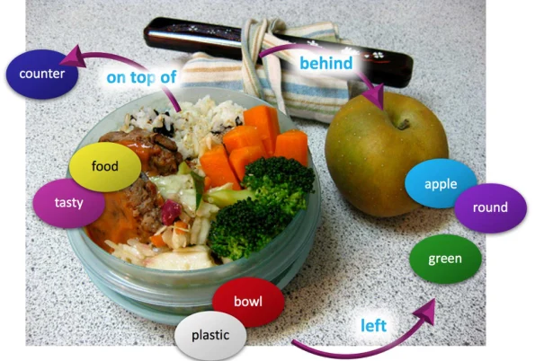
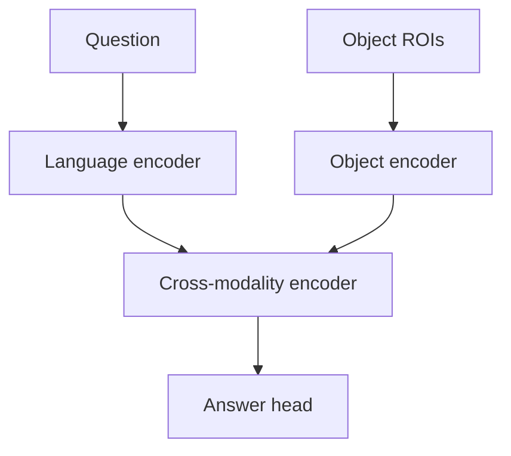

# GQA · Hỏi đáp dựa trên scene graph

Ảnh + câu hỏi → đáp án ngắn về quan hệ/thuộc tính.

**Metric** · Accuracy trên balanced split ↑, thêm breakdown theo loại câu

**Đề luyện 5 tiếng** · Chọn 4.000 câu, chia theo ảnh. Scene graph vàng chỉ dùng trong oracle có ghi rõ. [Dữ liệu và điều kiện truy cập](https://cs.stanford.edu/people/dorarad/gqa/).

Vị trí và quan hệ giữa vật thể là dữ kiện để trả lời câu hỏi. *Trích Hình 1, ảnh có grounding, Hudson & Manning.* [PDF gốc, trang 1](https://openaccess.thecvf.com/content_CVPR_2019/papers/Hudson_GQA_A_New_Dataset_for_Real-World_Visual_Reasoning_and_Compositional_CVPR_2019_paper.pdf#page=1).

## Từ baseline đến mô hình mạnh

1. **Baseline.** Question type → most frequent answer từ train.
2. **Thử nghiệm tiếp theo.** So question-only với oracle object/relation để đo khoảng trống perception. Dùng attention qua object proposals và cạnh không gian.
3. **Kiến trúc nghiên cứu.** LXMERT học các lớp object, language và cross-modality, paper có so sánh trên GQA.

## Kiến trúc để thử

Khối code có thể tái sử dụng · [Hai cách fusion bằng projection hoặc attention trên vùng](../blocks/fusion.py).

## Mốc công bố và hướng SOTA

Bảng 2 LXMERT công bố GQA test-standard. Ghi split balanced cùng điều kiện dùng object features. [Thí nghiệm hoặc kiến trúc gốc, tr. 6](https://aclanthology.org/D19-1514.pdf#page=6).

Đối chiếu accuracy và consistency qua evaluator GQA. Các bảng chỉ dùng balanced subset phải ghi đúng split. [Paper hoặc bảng đối chiếu](https://cs.stanford.edu/people/dorarad/gqa/index.html).

[← Trở về danh sách 30 challenge](../README.md)
